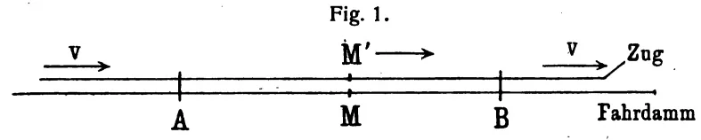
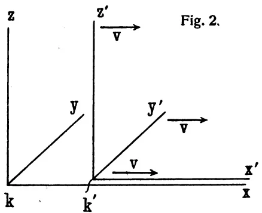
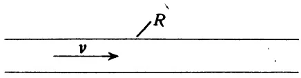
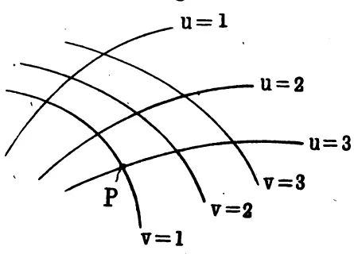

## Prefácio[^ne1]

O presente livrinho destina-se a proporcionar uma visão o mais exata possível da teoria da relatividade àqueles que, sob um ponto de vista científico geral e filosófico, se interessam pela teoria sem dominar o aparato matemático[^1] da física teórica. A leitura pressupõe aproximadamente a formação secundária completa (*Maturitätsbildung*)[^nt1] e — a despeito da brevidade do livrinho — bastante paciência e força de vontade por parte do leitor. O autor empenhou-se ao máximo para apresentar os pensamentos fundamentais com a maior clareza e simplicidade possíveis, em geral na mesma ordem e conexão em que eles efetivamente surgiram. No interesse da clareza, pareceu-me inevitável repetir-me com frequência, sem dedicar a menor consideração à elegância da exposição; ative-me conscientemente à máxima do genial teórico L. Boltzmann, segundo a qual se deve deixar a elegância a cargo de alfaiates e sapateiros. As dificuldades inerentes ao assunto creio não haver ocultado do leitor. Em contrapartida, tratei deliberadamente de modo secundário os fundamentos físicos empíricos da teoria, para que ao leitor não afeito à física não suceda como ao caminhante que, diante de tantas árvores, não enxerga a floresta. Possa este livrinho proporcionar a muitos algumas horas agradáveis de estímulo!

Dezembro de 1916.

A. Einstein.

### Adendo à Terceira Edição

Neste ano (1918), publicou-se pela editora Springer um compêndio detalhado e excelente da teoria da relatividade geral, de autoria de H. Weyl, intitulado *Raum · Zeit · Materie*[^nt2], obra calorosamente recomendada a matemáticos e físicos.

## Primeira Parte: Sobre a Teoria da Relatividade Especial

### § 1. Conteúdo Físico das Proposições Geométricas

Certamente tu também, caro leitor, travaste conhecimento, quando menino ou menina, com o altivo edifício da geometria de Euclides, e talvez te recordes, com mais respeito que afeição, da imponente construção em cujas altas escadarias foste impelido por professores conscienciosos ao longo de incontáveis horas. Por força desse teu passado, certamente censurarias com desdém quem quer que declarasse inverídica até mesmo a mais remota proposição dessa ciência. Contudo, esse sentimento de orgulhosa segurança talvez te abandonasse de imediato se alguém te perguntasse: «O que queres dizer afinal com a afirmação de que essas proposições são verdadeiras?». Detenhamo-nos um pouco sobre essa questão.

A geometria parte de certos conceitos fundamentais, tais como plano, ponto e reta, aos quais somos capazes de associar representações mais ou menos claras, e de certas proposições simples (axiomas) que, com base nessas representações, inclinamo-nos a aceitar como «verdadeiras». Todas as demais proposições são então reconduzidas a esses axiomas — ou seja, demonstradas — por meio de um método lógico cuja validade nos sentimos constrangidos a reconhecer. Uma proposição é correta ou «verdadeira» quando derivada dos axiomas segundo o procedimento reconhecido. A questão da «verdade» das proposições geométricas particulares reconduz-se, portanto, à questão da «verdade» dos axiomas. Há muito tempo, contudo, sabe-se que esta última questão não apenas é insolúvel pelos métodos da geometria, como também é, em si mesma, desprovida de sentido. Não se pode perguntar se é verdadeiro que por dois pontos passe apenas uma única reta. Pode-se apenas afirmar que a geometria euclidiana trata de entes a que denomina «retas», atribuindo-lhes a propriedade de serem univocamente determinados por dois de seus pontos. O conceito de «verdadeiro» não se aplica às asserções da geometria pura, porque pelo termo «verdadeiro» costumamos, em última análise, designar a correspondência com um objeto «real»; a geometria, todavia, não se ocupa da relação de seus conceitos com os objetos da experiência, mas unicamente da conexão lógica desses conceitos entre si.

Que nos sintamos, não obstante, impelidos a qualificar as proposições da geometria como «verdadeiras», explica-se com facilidade. Aos conceitos geométricos correspondem objetos na natureza de modo mais ou menos exato, sendo estes últimos, sem dúvida, a causa exclusiva da gênese de tais conceitos. Mesmo que a geometria, a fim de conferir ao seu edifício a máxima coesão lógica possível, se distancie dessa origem, o hábito de enxergar, por exemplo, em um segmento de reta dois pontos assinalados sobre um corpo praticamente rígido está profundamente enraizado em nossos hábitos mentais. Estamos, ademais, acostumados a considerar três pontos situados sobre uma mesma reta quando podemos fazer coincidir suas posições visuais aparentes mediante a escolha adequada do ponto de observação na visão monocular.

Se agora, seguindo esse hábito mental, acrescentarmos às proposições da geometria euclidiana a proposição única de que a dois pontos de um corpo praticamente rígido corresponde sempre a mesma distância (segmento), quaisquer que sejam as mudanças de posição que façamos o corpo sofrer, as proposições da geometria euclidiana convertem-se em proposições acerca da disposição espacial relativa possível de corpos praticamente rígidos[^2]. A geometria assim complementada deve então ser tratada como um ramo da física. Agora se pode legitimamente inquirir sobre a «verdade» de proposições geométricas assim interpretadas, pois é cabível indagar se tais proposições se aplicam àquelas coisas reais que associamos aos conceitos geométricos. Com ligeira imprecisão, podemos, portanto, afirmar que compreendemos por «verdade» de uma proposição geométrica, nesse sentido, a sua confirmação em uma construção com régua e compasso.

A convicção quanto à «verdade» das proposições geométricas nesse sentido repousa, naturalmente, de modo exclusivo sobre experiências bastante imperfeitas. Pressuporemos inicialmente essa verdade das proposições geométricas para, na última parte de nossas considerações (ao tratarmos da teoria da relatividade geral), constatar que e em que medida essa verdade possui os seus limites.

### § 2. O Sistema de Coordenadas

Com base na interpretação física da distância mencionada, estamos igualmente em condições de determinar a distância entre dois pontos de um corpo rígido mediante medições. Para tanto, necessitamos de um segmento a ser empregado de uma vez por todas (uma pequena haste $S$), a qual é utilizada como padrão de medida unitário. Se $A$ e $B$ são dois pontos de um corpo rígido, a reta que os une é construtível segundo as leis da geometria; sobre essa reta de união pode-se, a partir de $A$, transpor o segmento $S$ tantas vezes quantas forem necessárias até alcançar $B$. O número de repetições desse transporte constitui o valor numérico da medida do segmento $AB$. Nisto se baseia toda medição de comprimentos[^3].

Toda descrição espacial da posição de um acontecimento ou objeto repousa na indicação do ponto de um corpo rígido (corpo de referência) com o qual tal acontecimento coincide. Isto se aplica não apenas à descrição científica, mas também à vida cotidiana. Se analiso a indicação de lugar «em Berlim, na Potsdamer Platz»[^nt3], ela significa o seguinte: o solo terrestre é o corpo rígido ao qual a indicação se refere; nele, «Potsdamer Platz em Berlim» é um ponto assinalado e dotado de um nome, com o qual o acontecimento coincide espacialmente[^4].

Essa forma primitiva de indicação posicional conhece apenas posições sobre a superfície de corpos rígidos e acha-se vinculada à existência de pontos distinguíveis dessa superfície. Vejamos como o espírito humano se liberta dessas duas restrições sem que a essência da indicação de lugar sofra alteração! Se, por exemplo, uma nuvem paira sobre a Potsdamer Platz, sua posição em relação à superfície terrestre pode ser determinada erigindo-se verticalmente na praça uma haste que alcance a nuvem. O comprimento da haste medido com a régua padrão, em conjunção com a indicação da posição do pé da haste, constitui então uma indicação posicional completa. Por meio deste exemplo percebemos por qual via se processou o refinamento do conceito de posição:

a) Prolonga-se o corpo rígido ao qual a indicação se refere de tal modo que o objeto a ser localizado seja alcançado pelo corpo rígido completado.

b) Para caracterizar a posição, utiliza-se o número em vez de pontos de referência nomeados (no presente caso, o comprimento da haste medido com a régua).

c) Fala-se da altura da nuvem mesmo quando uma haste que a alcance não foi sequer erigida. No nosso exemplo, determina-se a partir de registros ópticos da nuvem efetuados de diferentes pontos do solo, levando em conta as propriedades de propagação da luz, que comprimento a haste precisaria ter para alcançar a nuvem.

A partir dessa reflexão compreende-se que será vantajoso para a descrição das posições conseguir, pelo emprego de valores numéricos de medição, tornar-se independente da existência de pontos de referência nomeados sobre o corpo rígido ao qual a indicação posicional se refere. Isso é alcançado pela física experimental mediante o emprego do sistema de coordenadas cartesiano.

Este consiste em três paredes planas rígidas e perpendiculares entre si, unidas a um corpo rígido. A posição de qualquer acontecimento em relação ao sistema de coordenadas é descrita (essencialmente) pela indicação do comprimento de três perpendiculares ou coordenadas $(x, y, z)$ que podem ser traçadas a partir do acontecimento sobre aquelas três paredes planas. Os comprimentos dessas três perpendiculares são determináveis mediante uma sucessão de operações com réguas rígidas, operações estas prescritas pelas leis e métodos da geometria euclidiana.

Nas aplicações práticas, aquelas paredes rígidas que formam o sistema de coordenadas em geral não estão concretizadas; além disso, as coordenadas não são realmente determinadas por construções com réguas rígidas, mas sim de maneira indireta. O significado físico das indicações posicionais deve, contudo, ser sempre buscado de acordo com as considerações precedentes, a menos que os resultados da física e da astronomia venham a se dissipar na obscuridade[^5].

Resulta, portanto, o seguinte: toda descrição espacial de acontecimentos recorre a um corpo rígido ao qual os acontecimentos devem ser espacialmente referidos. Essa referência pressupõe que para «segmentos» valham as leis da geometria euclidiana, sendo o «segmento» fisicamente representado por dois traços marcados sobre um corpo rígido.

### § 3. Espaço e Tempo na Mecânica Clássica

Se, sem graves escrúpulos e explicações minuciosas, formulo a tarefa da mecânica da seguinte maneira: «A mecânica deve descrever como os corpos alteram a sua posição no espaço ao longo do tempo», assumo em minha consciência alguns pecados capitais contra o espírito sagrado da clareza; esses pecados devem ser imediatamente expostos.

Não é claro o que se deve entender aqui por «posição» e «espaço». Encontro-me à janela de um vagão de trem que se desloca uniformemente e deixo cair uma pedra sobre o leito da via férrea, sem lhe imprimir impulso algum. Vejo então (abstraindo-se a influência da resistência do ar) a pedra cair em linha reta. Um pedestre que contempla o ato a partir do acostamento nota que a pedra cai ao solo descrevendo um arco de parábola. Pergunto agora: as «posições» que a pedra percorre situam-se, «na realidade», sobre uma reta ou sobre uma parábola? O que significa, ademais, «movimento no espaço»? A resposta é evidente após as reflexões do § 2. Primeiramente, deixamos de lado por completo a palavra obscura «espaço», sob a qual, em confissão sincera, nada somos capazes de conceber; colocamos em seu lugar «movimento em relação a um corpo de referência praticamente rígido». As posições em relação ao corpo de referência (vagão ou solo terrestre) já foram detalhadamente definidas no parágrafo anterior. Introduzindo, no lugar de «corpo de referência», o conceito de «sistema de coordenadas», útil para a descrição matemática, podemos dizer: a pedra descreve, em relação a um sistema de coordenadas rigidamente ligado ao vagão, uma linha reta; em relação a um sistema de coordenadas rigidamente ligado ao solo terrestre, uma parábola. Vê-se com clareza através deste exemplo que não existe uma trajetória[^6] em si mesma, mas apenas uma trajetória em relação a um determinado corpo de referência.

Uma descrição completa do movimento só se realiza, contudo, quando se indica como o corpo altera sua posição com o tempo; isto é, deve-se indicar para cada ponto da trajetória em que instante o corpo ali se encontra. Essas indicações precisam ser completadas por uma definição de tempo tal que esses valores temporais possam ser considerados, por força dessa definição, grandezas em princípio observáveis (resultados de medições). A essa exigência correspondemos — situando-nos no terreno da mecânica clássica — para o nosso exemplo da seguinte maneira: imaginamos dois relógios de construção exatamente idêntica; um deles está com o passageiro à janela do vagão, e o outro, nas mãos do homem no acostamento. Cada um dos dois constata em qual posição do respectivo corpo de referência a pedra se encontra exatamente no instante em que o relógio que tem na mão bate. Renunciamos aqui a entrar no mérito da imprecisão introduzida pelo fato de a velocidade de propagação da luz ser finita. Desta e de uma segunda dificuldade aqui reinante trataremos detalhadamente mais adiante.

### § 4. O Sistema de Coordenadas Galileano

Como é sabido, a lei fundamental da mecânica galileano-newtoniana, conhecida pelo nome de princípio da inércia, enuncia-se assim: todo corpo suficientemente afastado de outros corpos persevera em seu estado de repouso ou de movimento retilíneo e uniforme. Esta proposição não apenas assevera algo sobre o movimento dos corpos, mas também sobre os corpos de referência ou sistemas de coordenadas admissíveis na mecânica, os quais podem ser empregados na descrição mecânica. Corpos aos quais o princípio da inércia certamente pode ser aplicado com excelente aproximação são as estrelas fixas visíveis. Se utilizarmos agora um sistema de coordenadas rigidamente ligado à Terra, cada estrela fixa descreve em relação a ele, no decurso de um dia (astronômico), uma circunferência de raio descomunal, em flagrante contradição com o enunciado da lei da inércia. Se nos mantivermos fiéis a essa lei, só nos será permitido referir os movimentos a sistemas de coordenadas relativamente aos quais as estrelas fixas não executem movimentos circulares. Um sistema de coordenadas cujo estado de movimento seja tal que relativamente a ele vigore o princípio da inércia denominamos «sistema de coordenadas galileano». Somente para um sistema de coordenadas galileano as leis da mecânica de Galileu e Newton reivindicam validade.

### § 5. O Princípio da Relatividade (em Sentido Estrito)

Partimos novamente, a fim de alcançar a maior clareza intuitiva possível, do exemplo do vagão de trem que se desloca uniformemente. Denominamos o seu movimento uma translação uniforme («uniforme» porque dotada de velocidade e direção constantes; «translação» porque o vagão, embora altere sua posição relativamente ao leito da ferrovia, não executa rotações). Imagine-se um corvo voando em linha reta e com velocidade uniforme pelo ar — julgado a partir do leito da via férrea. Então — julgado a partir do vagão em movimento — o movimento do corvo é, decerto, um movimento com velocidade e direção distintas, mas é igualmente retilíneo e uniforme. Em termos abstratos: se uma massa $m$ move-se em linha reta e uniformemente em relação a um sistema de coordenadas $K$, ela se moverá também em linha reta e uniformemente em relação a um segundo sistema de coordenadas $K'$, caso este execute em relação a $K$ um movimento de translação uniforme. Daqui decorre, tendo em vista a exposição do parágrafo anterior:

Se $K$ é um sistema de coordenadas galileano, então todo outro sistema de coordenadas $K'$ que se encontre em estado de movimento translacional uniforme relativamente a $K$ será também galileano. Em relação a $K'$, as leis da mecânica de Galileu e Newton vigoram exatamente da mesma maneira que em relação a $K$.

Avançamos mais um passo na generalização ao enunciar a seguinte proposição: se $K'$ é um sistema de coordenadas que se move uniformemente e sem rotação em relação a $K$, os fenômenos naturais decorrem em relação a $K'$ segundo exatamente as mesmas leis gerais que em relação a $K$. A esta asserção denominamos «princípio da relatividade» (em sentido estrito).

Enquanto se manteve a convicção de que todos os fenômenos da natureza poderiam ser descritos com o auxílio da mecânica clássica, não se podia duvidar da validade deste princípio da relatividade. Com o desenvolvimento mais recente da eletrodinâmica e da óptica, porém, tornou-se cada vez mais manifesto que a mecânica clássica não fornecia base suficiente para a descrição física integral da natureza. Desse modo, a questão da validade do princípio da relatividade tornou-se perfeitamente discutível, e não parecia de modo algum excluído que a resposta a essa questão pudesse ser negativa.

Entretanto, há dois fatos de caráter geral que depõem de antemão fortemente a favor da validade do princípio da relatividade. Com efeito, mesmo que a mecânica clássica não proporcione uma base suficientemente ampla para a formulação teórica de todos os fenômenos físicos, ela deve conter um teor de verdade muito significativo, visto que fornece com admirável precisão os movimentos efetivos dos corpos celestes. Por conseguinte, o princípio da relatividade deve vigorar no domínio da mecânica, de qualquer modo, com grande exatidão. Mas que um princípio de tão elevada generalidade, válido com tal rigor em um domínio de fenômenos, venha a falhar diante de outro domínio, afigura-se *a priori* pouco provável.

O segundo argumento, sobre o qual voltaremos a falar mais adiante, é o seguinte: se o princípio da relatividade (em sentido estrito) não vigorasse, os sistemas de coordenadas galileanos $K, K', K''$, etc., que se movem uniformemente uns em relação aos outros, não seriam equivalentes para a descrição dos fenômenos naturais. Seria então quase inconcebível que as leis da natureza pudessem ser formuladas de maneira especialmente simples e natural apenas quando, dentre todos os sistemas galileanos, um único $(K_0)$ de determinado estado de movimento fosse escolhido como corpo de referência. A este sistema poderíamos então com justiça (em virtude de suas vantagens para a descrição da natureza) designar como «absolutamente em repouso», qualificando os demais sistemas galileanos $K$, em contrapartida, como «em movimento». Se, por exemplo, o leito de nossa ferrovia fosse o sistema $K_0$, nosso vagão seria um sistema $K$, em relação ao qual vigorariam leis menos simples do que em relação a $K_0$. Essa menor simplicidade decorreria do fato de que o vagão $K$ se moveria (ou seja, «realmente») em relação a $K_0$. Nessas leis naturais gerais formuladas em relação a $K$, a magnitude e a direção da velocidade de deslocamento do vagão teriam de desempenhar um papel. Seria de esperar, por exemplo, que o som emitido por um tubo de órgão fosse diferente quando este tivesse seu eixo disposto paralelamente à direção do movimento em comparação a quando disposto perpendicularmente a essa direção. Ora, a nossa Terra, em virtude de seu movimento orbital ao redor do Sol, é comparável a um vagão que se desloca a uma velocidade de cerca de $30\text{ km/s}$. Por conseguinte, em caso de invalidade do princípio da relatividade, seria de esperar que a direção momentânea do movimento da Terra entrasse nas leis da natureza, dependendo os sistemas físicos, em seu comportamento, de sua orientação espacial em relação à Terra. Pois, devido à variação na direção da velocidade do movimento orbital da Terra que ocorre ao longo do ano, ela não poderia permanecer em repouso em relação ao hipotético sistema $K_0$ durante todo o ano. Não obstante todo o rigor empregado, jamais se pôde observar semelhante anisotropia do espaço físico terrestre — ou seja, uma desigualdade física entre as diversas direções. Este constitui um argumento de peso extraordinário em favor do princípio da relatividade.

### § 6. O Teorema da Adição de Velocidades segundo a Mecânica Clássica

Desloque-se o vagão de trem frequentemente considerado com a velocidade constante $v$ sobre os trilhos. Dentro do vagão, caminhe um homem em sua extensão longitudinal no sentido da marcha com a velocidade $w$. Com que rapidez ou com que velocidade $W$ o homem avança relativamente ao leito da via férrea durante o caminhar? A única resposta possível parece brotar da seguinte reflexão:

Se o homem ficasse parado durante um segundo, avançaria em relação ao leito da via férrea uma distância $v$ igual à velocidade de deslocamento do vagão. Na realidade, contudo, ele percorre ademais relativamente ao vagão, e portanto também em relação ao leito da ferrovia, naquele segundo por meio de seu caminhar, a distância $w$, que é igual à sua velocidade de marcha. Ele percorre, pois, no segundo considerado, relativamente ao leito da via férrea, no total, a distância:

$$
W = v + w
$$

Mais adiante veremos que essa consideração, a qual expressa o teorema da adição de velocidades segundo a mecânica clássica, não pode ser sustentada, e que, portanto, a lei que acabamos de escrever não se confirma na verdade. Provisoriamente, contudo, nos fiaremos em sua exatidão.

### § 7. A Aparente Incompatibilidade da Lei de Propagação da Luz com o Princípio da Relatividade

Dificilmente existe na física uma lei mais simples do que aquela segundo a qual a luz se propaga no espaço vazio. Qualquer estudante sabe ou crê saber que essa propagação se dá em linha reta com a velocidade $c = 300\,000\text{ km/s}$. Sabemos, em todo caso com grande exatidão, que essa velocidade é a mesma para todas as cores; pois, se assim não fosse, na ocultação de uma estrela fixa por sua companheira escura o mínimo de emissão não seria observado simultaneamente para as diferentes cores. Por meio de reflexão análoga ligada às observações de estrelas binárias, o astrônomo holandês De Sitter pôde também demonstrar que a velocidade de propagação da luz não pode depender da velocidade de movimento do corpo que a emite. A suposição de que essa velocidade de propagação dependa da direção «no espaço» é em si mesma inverossímil.

Em suma, admitamos por ora que a lei simples da constância da velocidade da luz $c$ (no vácuo) seja legitimamente aceita pelo estudante! Quem haveria de supor que essa lei tão simples tenha lançado o físico que reflete com rigor nas maiores dificuldades de pensamento? Essas dificuldades apresentam-se da seguinte forma:

Naturalmente, devemos referir o processo de propagação da luz, como qualquer outro, a um corpo rígido de referência (sistema de coordenadas). Como tal, escolhemos novamente o leito de nossa ferrovia. Imaginemos que o ar sobre ela tenha sido totalmente evacuado. Ao longo do leito da via seja emitido um raio de luz cuja frente, consoante o exposto, propaga-se com velocidade $c$ relativamente ao leito. Sobre os trilhos desloque-se mais uma vez o nosso vagão de trem com velocidade $v$, no mesmo sentido em que o raio de luz se propaga, porém, naturalmente, com velocidade muito menor. Indagamos pela velocidade de propagação do raio de luz relativamente ao vagão. É fácil perceber que a reflexão do parágrafo anterior pode encontrar aplicação aqui; pois o homem que caminha em relação ao vagão desempenha o papel do raio de luz. No lugar de sua velocidade $W$ em relação ao leito da via surge aqui a velocidade da luz em relação a este; $w$ é a velocidade procurada da luz em relação ao vagão, para a qual vigora:

$$
w = c - v
$$

A velocidade de propagação do raio de luz relativamente ao vagão resulta, portanto, menor do que $c$.

Esse resultado atenta, contudo, contra o princípio da relatividade exposto no § 5. A lei de propagação da luz no vácuo teria de ter, com efeito, segundo o princípio da relatividade, exatamente a mesma formulação para o vagão de trem tomado como corpo de referência e para os trilhos tomados como corpo de referência, do mesmo modo que qualquer outra lei geral da natureza. Isso parece, todavia, impossível segundo a nossa consideração. Se todo raio de luz se propaga com velocidade $c$ em relação ao leito da ferrovia, parece precisamente por isso que a lei de propagação da luz em relação ao vagão deva ser outra — em contradição com o princípio da relatividade.

Diante desse dilema, afigura-se indispensável abandonar ou o princípio da relatividade ou a lei simples da propagação da luz no vácuo. Certamente o leitor que acompanhou atentamente as considerações até aqui esperará que o princípio da relatividade, que por sua naturalidade e simplicidade se impõe ao espírito como quase irrecusável, deva ser mantido, mas que a lei de propagação da luz no vácuo deva ser substituída por uma lei mais complexa, compatível com o princípio da relatividade. O desenvolvimento da física teórica demonstrou, no entanto, que esse caminho é inviável. As pioneiras pesquisas teóricas de H. A. Lorentz sobre os processos eletrodinâmicos e ópticos em corpos em movimento demonstraram que as experiências nesses domínios conduzem com imperiosa necessidade a uma teoria dos processos eletromagnéticos que tem como consequência incontornável a lei da constância da velocidade da luz no vácuo. Por isso, os teóricos eminentes estavam mais inclinados a abandonar o princípio da relatividade, conquanto não se pudesse apontar nenhum fato empírico sequer que contradissesse tal princípio.

Aqui interveio a teoria da relatividade. Mediante uma análise dos conceitos físicos de tempo e espaço, demonstrou-se que, na verdade, não há incompatibilidade alguma entre o princípio da relatividade e a lei de propagação da luz; antes, mantendo-se sistematicamente essas duas leis, atinge-se uma teoria logicamente impecável. Essa teoria, que para diferenciá-la de sua generalização a ser tratada mais adiante denominamos «teoria da relatividade especial», será exposta a seguir em seus pensamentos fundamentais.

### § 8. Sobre o Conceito de Tempo na Física

Em dois pontos $A$ e $B$ de nossa ferrovia, bastante distantes um do outro, caíram raios sobre os trilhos. Acrescento a afirmação de que esses dois golpes ocorreram simultaneamente. Se agora te pergunto, caro leitor, se essa asserção possui um sentido, responder-me-ás com um convicto «sim». Mas se agora insisto contigo com o pedido de que me expliques com mais exatidão o sentido de tal afirmação, notarás, após alguma reflexão, que a resposta a essa pergunta não é tão simples quanto parece à primeira vista.

Após algum tempo, talvez te ocorra a seguinte resposta: «O significado da afirmação é claro em si mesmo e não carece de elucidação adicional; eu teria, decerto, de despender alguma reflexão se recebesse a incumbência de averiguar, por meio de observações, se no caso concreto os dois acontecimentos tiveram lugar simultaneamente ou não». Com essa resposta não posso, porém, contentar-me, pela seguinte razão: suponha-se que um hábil meteorologista houvesse descoberto, mediante reflexões argutas, que nos pontos $A$ e $B$ o raio deve sempre cair simultaneamente; surge então a tarefa de verificar se esse resultado teórico corresponde ou não à realidade. O mesmo sucede com todas as asserções físicas em que o conceito de «simultâneo» desempenha um papel. Esse conceito só existe para o físico quando se dá a possibilidade de descobrir, no caso concreto, se ele se aplica ou não. Faz-se mister, portanto, uma definição de simultaneidade tal que forneça o método segundo o qual se possa decidir por meio de experimentos, no caso presente, se ambos os raios caíram simultaneamente ou não. Enquanto essa exigência não for satisfeita, entrego-me como físico (e decerto também como não físico!) a uma ilusão se creio poder associar um sentido à afirmação de simultaneidade. (Antes que me tenhas concedido este ponto com plena convicção, caro leitor, não prossigas na leitura.)

Após algum tempo de reflexão, fazes então a seguinte proposta para a constatação da simultaneidade: meça-se a distância de união $AB$ ao longo dos trilhos e coloque-se no ponto médio $M$ dessa extensão um observador munido de um dispositivo (por exemplo, dois espelhos inclinados em $90^\circ$ entre si) que lhe permita uma fixação óptica simultânea de ambos os pontos $A$ e $B$. Se ele perceber ambos os relâmpagos simultaneamente, então eles são simultâneos.

Fico muito satisfeito com essa proposta e, não obstante, considero a questão ainda não inteiramente esclarecida, porque me sinto impelido à seguinte objeção: «Tua definição seria absolutamente correta se eu já soubesse que a luz que transmite ao observador em $M$ a percepção dos relâmpagos se propaga com a mesma velocidade no percurso $A \to M$ e no percurso $B \to M$. Uma verificação dessa premissa só seria possível, todavia, se já dispuséssemos dos meios para medir o tempo. Parece, pois, que nos movemos aqui em um círculo vicioso».

Após nova reflexão, lanças-me com razão um olhar algo desdenhoso e me declaras: «Mantenho, não obstante, a minha definição anterior, visto que ela, na verdade, nada pressupõe acerca da luz. À definição de simultaneidade cabe fazer apenas a exigência única de que, em cada caso real, ela forneça uma decisão empírica sobre a procedência ou improcedência do conceito a ser definido. Que a minha definição cumpre isso, é indiscutível. Que a luz necessite do mesmo tempo para percorrer o trajeto $A \to M$ e para percorrer o trajeto $B \to M$ não é, em verdade, nenhuma premissa ou hipótese sobre a natureza física da luz, mas sim uma convenção que posso adotar a meu livre arbítrio para alcançar uma definição de simultaneidade».

É evidente que essa definição pode ser utilizada para conferir um sentido exato à afirmação de simultaneidade não apenas de dois acontecimentos, mas de quantos acontecimentos se queira, qualquer que seja a disposição espacial dos locais dos acontecimentos relativamente ao corpo de referência (aqui, o leito da ferrovia)[^7]. Com isso, atinge-se também uma definição de «tempo» na física. Imagine-se, com efeito, nos pontos $A$, $B$ e $C$ dos trilhos (sistema de coordenadas), relógios de idêntica construção dispostos e regulados de tal modo que as posições de seus ponteiros sejam simultaneamente (no sentido acima) as mesmas. Compreende-se então por «tempo» de um acontecimento a indicação temporal (posição dos ponteiros) daquele dentre esses relógios que for imediatamente vizinho (espacialmente) ao acontecimento. Desse modo, associa-se a cada acontecimento um valor temporal que, em princípio, pode ser observado.

Essa convenção encerra ainda uma hipótese física sobre cuja procedência dificilmente se duvidará sem contraprovas empíricas. Supõe-se, a saber, que todos esses relógios funcionem «com igual rapidez» quando construídos de modo idêntico. Expresso com rigor: se dois relógios dispostos em repouso em diferentes pontos do corpo de referência forem ajustados de modo que uma dada posição dos ponteiros de um seja simultânea (no sentido exposto) à mesma posição dos ponteiros do outro, posições idênticas de ponteiros serão em geral simultâneas (no sentido da definição anterior).

### § 9. A Relatividade da Simultaneidade

Até agora referimos nossa consideração a um corpo de referência determinado, que designamos como «leito da via férrea». Desloque-se agora sobre os trilhos um trem muito longo com velocidade constante $v$ na direção indicada na Fig. 1. Os indivíduos que viajam nesse trem utilizarão vantajosamente a composição ferroviária como corpo rígido de referência (sistema de coordenadas); eles referem todos os acontecimentos ao trem. Cada acontecimento que tem lugar ao longo dos trilhos ocorre também, por conseguinte, em um determinado ponto do trem. A definição de simultaneidade pode ser dada em relação ao trem exatamente da mesma maneira como em relação ao leito da ferrovia. Surge agora, porém, com naturalidade a seguinte pergunta:

Dois acontecimentos (por exemplo, os dois golpes de raio $A$ e $B$) que são simultâneos em relação ao leito da via férrea são também simultâneos em relação ao trem? Demonstraremos em seguida que a resposta tem de ser negativa.

Quando dizemos que os raios $A$ e $B$ são simultâneos em relação ao leito da ferrovia, isso significa: os raios de luz que partem dos locais dos raios $A$ e $B$ encontram-se no ponto médio $M$ do segmento de via férrea $A$–$B$. Aos acontecimentos $A$ e $B$ correspondem também, porém, posições $A$ e $B$ sobre o trem. Seja $M'$ o ponto médio do segmento $A$–$B$ do trem em movimento. Este ponto $M'$ coincide decerto com o ponto $M$ no instante dos raios[^8], mas desloca-se, no desenho, para a direita com a velocidade $v$ do trem. Se um observador sentado no trem em $M'$ não possuísse essa velocidade, permaneceria permanentemente em $M$, e os raios de luz provenientes dos golpes de raio $A$ e $B$ o alcançariam simultaneamente — isto é, ambos os raios se encontrariam precisamente diante dele. Na realidade, contudo, ele corre (julgado a partir do leito da via férrea) ao encontro do raio de luz proveniente de $B$, enquanto foge do raio de luz que vem de $A$. O observador verá, portanto, o raio luminoso que parte de $B$ antes do raio que parte de $A$. Os observadores que utilizam o trem como corpo de referência devem chegar, por conseguinte, ao resultado de que o raio $B$ caiu antes do raio $A$. Chegamos assim ao importante resultado:

Acontecimentos que são simultâneos em relação ao leito da ferrovia não são simultâneos em relação ao trem, e vice-versa (relatividade da simultaneidade). Todo corpo de referência (sistema de coordenadas) possui o seu tempo particular; uma indicação de tempo só tem sentido quando se indica o corpo de referência ao qual ela se refere.

Antes da teoria da relatividade, a física sempre supôs tacitamente que a significação das indicações temporais era de caráter absoluto — isto é, independente do estado de movimento do corpo de referência. Que essa suposição seja, contudo, incompatível com a definição mais natural de simultaneidade, acabamos de ver; abandonando-a, desvanece-se o conflito entre a lei de propagação da luz no vácuo e o princípio da relatividade formulado no § 7.

A esse conflito conduziu, com efeito, a consideração do § 6, a qual já não pode ser mantida. Concluímos ali que o passageiro no vagão que percorre relativamente a este a distância $w$ em um segundo percorre essa distância também relativamente ao leito da ferrovia em um segundo. Como, porém, de acordo com as reflexões recém-realizadas, o tempo que um determinado processo requer em relação ao vagão não pode ser igualado à duração do mesmo processo julgada a partir do leito da via férrea tomado como corpo de referência, não se pode sustentar que o homem, ao caminhar relativamente aos trilhos, percorra a distância $w$ em um tempo que — julgado do leito da via férrea — seja igual a um segundo.

A reflexão do § 6 repousa, aliás, ainda sobre uma segunda premissa que, à luz de um exame rigoroso, se afigura arbitrária, embora antes do surgimento da teoria da relatividade haja sido sempre feita (tacitamente).

### § 10. Sobre a Relatividade do Conceito de Distância Espacial

Consideramos dois pontos determinados do trem que se desloca ao longo da ferrovia com velocidade[^9] $v$ e indagamos pela sua distância. Já sabemos que para a medição de uma distância necessita-se de um corpo de referência em relação ao qual a distância seja medida. O mais simples consiste em utilizar o próprio trem como corpo de referência (sistema de coordenadas). Um observador que viaja no trem mede a distância sobrepondo em linha reta a sua régua de medição, por exemplo ao longo do assoalho dos vagões, tantas vezes quantas forem necessárias até passar de um ponto marcado ao outro. O número que indica quantas vezes a régua teve de ser aplicada é então a distância procurada.

Outro é o caso quando a distância deve ser avaliada a partir dos trilhos. Apresenta-se aí o seguinte método: denominando-se $A'$ e $B'$ os dois pontos do trem cuja distância se quer determinar, esses dois pontos movem-se com a velocidade $v$ ao longo da ferrovia. Perguntamos inicialmente pelos pontos $A$ e $B$ do leito da via férrea defronte dos quais os dois pontos $A'$ e $B'$ passam exatamente em um determinado instante $t$ — julgado a partir do leito da ferrovia. Esses pontos $A$ e $B$ da via férrea são determináveis por meio da definição de tempo dada no § 8. Em seguida, a distância desses pontos $A$ e $B$ é medida pela aplicação sucessiva da régua métrica ao longo do leito da via.

Não está de modo algum decidido *a priori* que essa última medição deva produzir o mesmo resultado que a primeira. Medido a partir do leito da ferrovia, o comprimento do trem pode, portanto, ser diferente do medido a partir do próprio trem. Essa circunstância engendra uma segunda objeção a ser levantada contra a reflexão aparentemente tão evidente do § 6. Com efeito, se o homem no vagão percorre na unidade de tempo — medida a partir do trem — a distância $w$, essa distância — medida a partir do leito da via férrea — não precisa ser também igual a $w$.

### § 11. A Transformação de Lorentz

As reflexões dos últimos três parágrafos mostram-nos que a aparente incompatibilidade da lei de propagação da luz com o princípio da relatividade no § 7 foi deduzida mediante uma consideração que tomou de empréstimo à mecânica clássica duas hipóteses injustificadas; essas hipóteses enunciam-se assim:

1. O intervalo de tempo entre dois acontecimentos é independente do estado de movimento do corpo de referência.
2. A distância espacial entre dois pontos de um corpo rígido é independente do estado de movimento do corpo de referência.

Se abandonamos essas hipóteses, desaparece o dilema do § 7, visto que o teorema da adição de velocidades deduzido no § 6 torna-se inválido. Surge diante de nós a possibilidade de que a lei da propagação da luz no vácuo possa ser compatível com o princípio da relatividade. Chegamos à questão: como deve ser modificada a reflexão do § 6 a fim de eliminar a aparente contradição entre esses dois resultados fundamentais da experiência? Essa questão conduz a uma indagação geral: na consideração do § 6 intervêm posições e tempos relativos ao trem e relativos ao leito da ferrovia. Como se determinam a posição e o tempo de um acontecimento em relação ao trem quando a posição e o tempo desse mesmo acontecimento são conhecidos em relação ao leito da ferrovia? Existe uma resposta concebível a essa pergunta tal que a lei de propagação da luz no vácuo não contradiga o princípio da relatividade? Dito de outro modo: é concebível uma relação entre posição e tempo dos acontecimentos particulares relativamente a ambos os corpos de referência de tal sorte que todo raio de luz possua a velocidade de propagação $c$ tanto em relação ao leito da via férrea quanto em relação ao trem? Essa questão conduz a uma resposta afirmativa inteiramente determinada, a uma lei de transformação bastante precisa para as grandezas de espaço e tempo de um acontecimento na passagem de um corpo de referência a outro.

Antes de entrarmos no mérito dessa questão, intercalemos a seguinte reflexão preliminar: até o momento consideramos apenas acontecimentos que se desenrolavam ao longo do leito da via férrea, o qual, matematicamente, devia desempenhar a função de uma linha reta. Pode-se, todavia, da maneira indicada no § 2, conceber esse corpo de referência prolongado lateralmente e para cima mediante uma armação de réguas rígidas de tal modo que um acontecimento que ocorra em qualquer lugar possa ser localizado relativamente a essa armação. Analogamente, pode-se imaginar o trem que se desloca com velocidade $v$ prolongado por todo o espaço, de modo que qualquer acontecimento, por mais distante que se encontre, possa também ser localizado em relação a essa segunda armação. Podemos desconsiderar, sem incorrer em erros de princípio, o fato de que essas armações na realidade destruir-se-iam mutuamente em virtude da impenetrabilidade dos corpos sólidos. Em cada uma dessas armações imaginamos três paredes perpendiculares entre si assinaladas e designadas como «planos coordenados» («sistema de coordenadas»). Ao leito da ferrovia corresponde então um sistema de coordenadas $K$, e ao trem, um sistema de coordenadas $K'$. Um acontecimento que ocorre em qualquer ponto é espacialmente fixado em relação a $K$ pelas três perpendiculares $x, y, z$ sobre os planos coordenados, e temporalmente fixado por um valor de tempo $t$. O mesmo acontecimento é fixado no espaço-tempo relativamente a $K'$ por valores correspondentes $x', y', z', t'$, os quais, naturalmente, não coincidem com $x, y, z, t$. A maneira como essas grandezas devem ser concebidas como resultados de medições físicas já foi exposta detalhadamente no início.

Nosso problema formulado com rigor enuncia-se evidentemente assim: quão grandes são os valores $x', y', z', t'$ de um acontecimento em relação a $K'$ quando são dadas as grandezas $x, y, z, t$ do mesmo acontecimento em relação a $K$? As relações devem ser escolhidas de tal maneira que a lei de propagação da luz no vácuo seja satisfeita para um mesmo raio de luz (e a saber, para cada um deles) em relação a $K$ e a $K'$. Esse problema é resolvido para a orientação espacial relativa dos sistemas de coordenadas indicada na Fig. 2 pelas equações:

$$
\begin{aligned}
x' &= \frac{x - v t}{\sqrt{1 - \frac{v^2}{c^2}}} \\
y' &= y \\
z' &= z \\
t' &= \frac{t - \frac{v}{c^2} x}{\sqrt{1 - \frac{v^2}{c^2}}}
\end{aligned}
$$

sistema de equações que se designa pelo nome de «transformação de Lorentz»[^10].

Se, todavia, em lugar da lei de propagação da luz, tivéssemos tomado por base as premissas tácitas da antiga mecânica acerca do caráter absoluto dos tempos e dos comprimentos, teríamos chegado, em vez dessas equações de transformação, às equações:

$$
\begin{aligned}
x' &= x - v t \\
y' &= y \\
z' &= z \\
t' &= t
\end{aligned}
$$

sistema que com frequência se denomina «transformação de Galileu». A transformação de Galileu decorre da transformação de Lorentz fazendo-se nesta última a velocidade da luz $c$ tender a um valor infinitamente grande.

Que segundo a transformação de Lorentz a lei de propagação da luz no vácuo é satisfeita tanto para o corpo de referência $K$ quanto para o corpo de referência $K'$, constata-se com facilidade por meio do seguinte exemplo: envie-se um sinal luminoso ao longo do eixo positivo dos $x$, propagando-se a excitação luminosa de acordo com a equação:

$$
x = c t
$$

isto é, com a velocidade $c$. De acordo com as equações da transformação de Lorentz, essa relação simples entre $x$ e $t$ acarreta uma relação entre $x'$ e $t'$. Com efeito, a primeira e a quarta equação da transformação de Lorentz fornecem, introduzindo-se nelas o valor $ct$ para $x$:

$$
x' = \frac{(c - v) t}{\sqrt{1 - \frac{v^2}{c^2}}}
$$

$$
t' = \frac{\left(1 - \frac{v}{c}\right) t}{\sqrt{1 - \frac{v^2}{c^2}}}
$$

das quais se segue imediatamente por divisão:

$$
x' = c t'
$$

De acordo com essa equação processa-se a propagação da luz quando referida ao sistema $K'$. Revela-se, portanto, que a velocidade de propagação também é igual a $c$ relativamente ao corpo de referência $K'$. O mesmo sucede com raios luminosos que se propagam em qualquer outra direção. Isto, naturalmente, não é de surpreender, pois as equações da transformação de Lorentz foram deduzidas precisamente sob esse ponto de vista.

### § 12. O Comportamento de Réguas e Relógios em Movimento

Coloco uma régua métrica no eixo dos $x'$ de $K'$ de tal modo que o seu início coincida com o ponto $x' = 0$ e o seu final com o ponto $x' = 1$. Qual é o comprimento da régua métrica relativamente ao sistema $K$? Para saber isso, basta-nos indagar onde se situam o início e o fim da régua relativamente a $K$ em um determinado instante $t$ do sistema $K$. Encontra-se para esses dois pontos a partir da primeira equação da transformação de Lorentz para o instante $t = 0$:

$$
x_{\text{(início da régua)}} = 0 \cdot \sqrt{1 - \frac{v^2}{c^2}}
$$

$$
x_{\text{(fim da régua)}} = 1 \cdot \sqrt{1 - \frac{v^2}{c^2}}
$$

pontos estes cuja distância mútua é $\sqrt{1 - \frac{v^2}{c^2}}$. Relativamente a $K$, porém, a régua métrica move-se com a velocidade $v$. Decorre, portanto, que o comprimento de uma régua métrica rígida que se move com a velocidade $v$ na direção de seu comprimento é de

$$
\sqrt{1 - \frac{v^2}{c^2}}
$$

metros. A régua rígida em movimento é, pois, mais curta do que a mesma régua quando se encontra em estado de repouso, e tanto mais curta quanto mais rapidamente se move. Para a velocidade $v = c$, ter-se-ia $\sqrt{1 - \frac{v^2}{c^2}} = 0$, e para velocidades ainda maiores a raiz torna-se imaginária. Concluímos daí que na teoria da relatividade a velocidade $c$ desempenha o papel de uma velocidade-limite que não pode ser alcançada nem superada por nenhum corpo real.

Esse papel da velocidade $c$ como velocidade-limite decorre, aliás, já das próprias equações da transformação de Lorentz; pois estas perdem o sentido se $v$ for escolhido maior do que $c$.

Se, inversamente, tivéssemos considerado uma régua métrica em repouso no eixo dos $x$ relativamente a $K$, teríamos constatado que ela, julgada a partir de $K'$, possui o comprimento $\sqrt{1 - \frac{v^2}{c^2}}$; isto se acha em perfeito acordo com o princípio da relatividade, tomado por base em nossas considerações.

Que devamos deduzir das equações de transformação algo acerca do comportamento físico de réguas e relógios é evidente *a priori*; pois as grandezas $x, y, z, t$ nada mais são que resultados de medições a serem obtidos com réguas e relógios. Se tivéssemos tomado por base a transformação de Galileu, não teríamos obtido nenhuma contração da régua em virtude do movimento.

Consideramos agora um relógio de segundos que permanece em repouso contínuo na origem $(x' = 0)$ de $K'$. Sejam $t' = 0$ e $t' = 1$ duas batidas sucessivas desse relógio. Para essas duas batidas, a primeira e a quarta equação da transformação de Lorentz fornecem:

$$
t = 0
$$

e

$$
t = \frac{1}{\sqrt{1 - \frac{v^2}{c^2}}}
$$

Julgado a partir de $K$, o relógio move-se com a velocidade $v$; avaliado a partir desse corpo de referência, transcorre entre duas de suas batidas não um segundo, mas $\frac{1}{\sqrt{1 - \frac{v^2}{c^2}}}$ segundos — ou seja, um tempo um pouco maior. O relógio funciona, em consequência de seu movimento, mais lentamente do que no estado de repouso. Também aqui a velocidade $c$ desempenha o papel de uma velocidade-limite inalcançável.

### § 13. Teorema da Adição de Velocidades: O Experimento de Fizeau

Como na prática só podemos mover relógios e réguas com velocidades muito pequenas em comparação com a velocidade da luz $c$, os resultados do parágrafo anterior dificilmente poderiam ser confrontados de modo direto com a realidade. Visto que esses resultados parecerão, por outro lado, bastante singulares ao leitor, quero extrair agora da teoria outra consequência facilmente dedutível do que foi exposto até aqui e que é brilhantemente confirmada pelo experimento.

No § 6 deduzimos o teorema da adição para velocidades de mesma direção, tal como resulta das hipóteses da mecânica clássica. O mesmo decorre também com facilidade da transformação de Galileu (§ 11). Em vez do homem que caminha no vagão, introduzimos um ponto que se move relativamente ao sistema de coordenadas $K'$ segundo a equação:

$$
x' = w t'
$$

A partir da primeira e quarta equações da transformação de Galileu pode-se exprimir $x'$ e $t'$ por meio de $x$ e $t$, obtendo-se:

$$
x = (v + w) t
$$

Esta equação nada mais expressa do que a lei de movimento do ponto em relação ao sistema $K$ (do homem em relação ao leito da ferrovia), velocidade esta que designamos por $W$, de sorte que se obtém, como no § 6:

$$
W = v + w \tag{A}
$$

Podemos, todavia, realizar essa mesma consideração tomando por base a teoria da relatividade. Tem-se então de exprimir na equação:

$$
x' = w t'
$$

$x'$ e $t'$ em função de $x$ e $t$ empregando a primeira e a quarta equações da transformação de Lorentz. Obtém-se então, em vez da equação (A), a equação:

$$
W = \frac{v + w}{1 + \frac{v w}{c^2}} \tag{B}
$$

a qual corresponde ao teorema da adição de velocidades de mesma direção segundo a teoria da relatividade. A questão reside agora em saber qual desses dois teoremas resiste ao confronto com a experiência. A esse respeito instrui-nos um experimento de máxima importância que o genial físico Fizeau realizou há mais de meio século, e que desde então foi repetido por alguns dos mais notáveis físicos experimentais, de modo que o resultado é indubitável. O experimento trata da seguinte questão: em um líquido em repouso a luz propaga-se com determinada velocidade $w$. Com que rapidez ela se propaga no tubo $R$ da figura no sentido da seta quando este é atravessado pelo referido líquido com a velocidade $v$?

Deveremos admitir de antemão, no sentido do princípio da relatividade, que relativamente ao líquido a propagação da luz ocorra sempre com a mesma velocidade $w$, quer o líquido esteja em movimento em relação a outros corpos, quer não. Conhecem-se, portanto, a velocidade da luz relativamente ao líquido e a velocidade deste último relativamente ao tubo; procura-se a velocidade da luz relativamente ao tubo.

É claro que temos aqui novamente diante de nós a tarefa do § 6: o tubo desempenha o papel do leito da via férrea ou do sistema de coordenadas $K$; o líquido, o papel do vagão ou do sistema de coordenadas $K'$; a luz, enfim, o papel do homem que caminha no vagão ou do ponto móvel considerado neste parágrafo. Designando-se, portanto, por $W$ a velocidade da luz relativamente ao tubo, esta é dada pela equação (A) ou (B), conforme a transformação de Galileu ou a transformação de Lorentz corresponda à realidade.

O experimento[^11] decide a favor da equação (B) deduzida da teoria da relatividade, e isso com grande exatidão. O influxo da velocidade de escoamento $v$ sobre a propagação da luz é representado pela fórmula (B) com precisão superior a 1%, de acordo com as excelentes e recentes medições de Zeeman.

Cumpre agora ressaltar, decerto, que uma teoria desse fenômeno foi formulada por H. A. Lorentz muito antes do advento da teoria da relatividade por via puramente eletrodinâmica, mediante o emprego de hipóteses determinadas sobre a estrutura eletromagnética da matéria. Essa circunstância em nada diminui, porém, a força probatória do ensaio como *experimentum crucis* em favor da teoria da relatividade. Com efeito, a eletrodinâmica de Maxwell-Lorentz, na qual se apoiava a teoria original, não se encontra em oposição alguma à teoria da relatividade. Esta última, antes, brotou da eletrodinâmica como uma síntese e generalização surpreendentemente simples das hipóteses outrora independentes entre si sobre as quais a eletrodinâmica se achava edificada.

### § 14. O Valor Heurístico da Teoria da Relatividade

A cadeia de pensamentos até aqui exposta pode ser resumida brevemente do seguinte modo: a experiência conduziu à convicção de que, por um lado, vigora o princípio da relatividade (em sentido estrito) e de que, por outro lado, a velocidade de propagação da luz no vácuo deve ser fixada como igual a uma constante $c$. Pela união desses dois postulados resultou a lei de transformação para as coordenadas retangulares $x, y, z$ e para o tempo $t$ dos acontecimentos que compõem o devir natural, resultando não a transformação de Galileu, mas (afastando-se da mecânica clássica) a transformação de Lorentz.

Nessa cadeia de reflexões desempenhou papel capital a lei de propagação da luz, cuja admissão se justifica pelo nosso conhecimento efetivo. Uma vez de posse da transformação de Lorentz, podemos, contudo, combiná-la com o princípio da relatividade e condensar a teoria na seguinte proposição:

Toda lei geral da natureza deve ter uma constituição tal que se transforme em uma lei de formulação exatamente idêntica quando, em vez das variáveis espaço-temporais $x, y, z, t$ do sistema de coordenadas originário $K$, introduzirem-se novas variáveis espaço-temporais $x', y', z', t'$ de um sistema de coordenadas $K'$, sendo a conexão matemática entre as grandezas com e sem apóstrofo dada pela transformação de Lorentz. Formulado de modo conciso: as leis gerais da natureza são covariantes relativamente a transformações de Lorentz.

Trata-se de uma condição matemática determinada que a teoria da relatividade prescreve a uma lei natural; por meio dela, a teoria converte-se em um valioso recurso heurístico na busca das leis gerais da natureza. Caso se encontrasse uma lei natural geral que não correspondesse a essa condição, pelo menos uma das duas premissas fundamentais da teoria estaria refutada. Vejamos agora que resultados de alcance geral ela produziu até o presente momento.

### § 15. Resultados Gerais da Teoria

A partir das exposições precedentes, evidencia-se que a teoria da relatividade (especial) brotou da eletrodinâmica e da óptica. Nesses domínios, ela não alterou substancialmente as proposições da teoria, mas simplificou consideravelmente o edifício teórico — isto é, a dedução das leis — e, o que é incomparavelmente mais importante, reduziu sobremaneira o número de hipóteses independentes entre si sobre as quais a teoria repousava. Ela conferiu à teoria de Maxwell-Lorentz tal grau de evidência que esta se teria imposto de modo geral entre os físicos mesmo se o experimento houvesse deposto de maneira menos convincente em seu favor.

A mecânica clássica necessitou inicialmente de uma modificação para harmonizar-se com a exigência da teoria da relatividade especial. Essa modificação diz respeito, no entanto, essencialmente apenas às leis para movimentos rápidos, nos quais as velocidades $v$ da matéria não são por demais pequenas em confronto com a velocidade da luz. Movimentos tão rápidos a experiência no-los revela somente em elétrons e íons; em outros movimentos, os desvios em relação às leis da mecânica clássica são demasiado reduzidos para se fazerem notar na prática. Do movimento dos corpos celestes só se falará ao tratarmos da teoria da relatividade geral. Conforme a teoria da relatividade, a energia cinética de um ponto material de massa $m$ já não é dada pela conhecida expressão:

$$
m \frac{v^2}{2}
$$

mas sim pela expressão:

$$
\frac{m c^2}{\sqrt{1 - \frac{v^2}{c^2}}}
$$

Essa expressão torna-se infinita quando a velocidade $v$ aproxima-se da velocidade da luz $c$. A velocidade deve, portanto, permanecer sempre menor do que $c$, por maiores que sejam as energias empregadas na aceleração. Desenvolvendo-se a expressão da energia em série, obtém-se:

$$
m c^2 + m \frac{v^2}{2} + \frac{3}{8} m \frac{v^4}{c^2} + \dots
$$

O terceiro desses termos é sempre pequeno em face do segundo (o único considerado na mecânica clássica) quando $\frac{v^2}{c^2}$ é pequeno em relação a 1. O primeiro termo, $mc^2$, não contém a velocidade, não entrando, pois, em consideração quando se trata unicamente da questão de saber como a energia de um ponto material depende da velocidade. Acerca de seu significado de princípio falar-se-á em seguida.

O resultado mais importante de caráter geral a que conduziu a teoria da relatividade especial concerne ao conceito de massa. A física pré-relativística conhece dois princípios de conservação de importância fundamental, a saber, o princípio da conservação da energia e o princípio da conservação da massa; essas duas leis fundamentais afiguravam-se inteiramente independentes entre si. Pela teoria da relatividade, elas fundem-se em um único princípio. Como isso se deu e como se deve conceber essa fusão será exposto sucintamente a seguir.

O princípio da relatividade exige que o princípio da conservação da energia vigore não apenas relativamente a um sistema de coordenadas $K$, mas relativamente a todo sistema de coordenadas $K'$ que se encontre em estado de movimento translacional uniforme relativamente a $K$ (dito de modo breve, relativamente a todo sistema de coordenadas «galileano»). Para a passagem entre dois desses sistemas é determinante, em contraste com a mecânica clássica, a transformação de Lorentz.

A partir dessas premissas, em conjunção com as equações fundamentais da eletrodinâmica de Maxwell, pode-se com imperiosa necessidade, mediante reflexões relativamente simples, extrair a seguinte conclusão: um corpo que se desloca com velocidade $v$, ao absorver sob a forma de radiação a energia[^12] $E_0$ sem que com isso sua velocidade se altere, experimenta um acréscimo de sua energia no montante de:

$$
\frac{E_0}{\sqrt{1 - \frac{v^2}{c^2}}}
$$

A energia procurada do corpo é dada então, tendo em conta a expressão precedentemente indicada para a energia cinética, por:

$$
\frac{\left(m + \frac{E_0}{c^2}\right) c^2}{\sqrt{1 - \frac{v^2}{c^2}}}
$$

O corpo possui, portanto, a mesma energia que um corpo de massa $m + \frac{E_0}{c^2}$ que se desloca com a velocidade $v$. Pode-se dizer, por conseguinte: se um corpo absorve a energia $E_0$, sua massa inercial cresce no montante de $\frac{E_0}{c^2}$; a massa inercial de um corpo não é uma constante, mas variável na medida de sua alteração de energia. A massa inercial de um sistema de corpos pode ser tomada perfeitamente como medida de sua energia. O princípio da conservação da massa de um sistema coincide com o princípio da conservação da energia e vigora somente na medida em que o sistema não absorve nem emite energia. Escrevendo-se a expressão para a energia na forma:

$$
\frac{m c^2 + E_0}{\sqrt{1 - \frac{v^2}{c^2}}}
$$

vê-se que o termo $mc^2$, que nos chamou a atenção anteriormente, nada mais é do que a energia que o corpo já possuía[^13] antes de haver absorvido a energia $E_0$.

A confrontação direta dessa proposição com a experiência esbarra provisoriamente no fato de que as alterações de energia $E_0$ que somos capazes de imprimir a um sistema não são suficientemente grandes para se fazerem notar como alteração da massa inercial do sistema. $\frac{E_0}{c^2}$ é demasiado pequeno em comparação com a massa $m$ existente antes da variação de energia. É a essa circunstância que se deve o fato de haver sido possível enunciar com êxito um princípio da conservação da massa de vigência autônoma.

Resta ainda uma última observação de natureza de princípio. O êxito da interpretação de Faraday e Maxwell da ação eletromagnética à distância mediante processos intermediários dotados de velocidade finita de propagação fez com que se consolidasse entre os físicos a convicção de que não existem ações à distância imediatas e instantâneas do tipo da lei de gravitação de Newton. Conforme a teoria da relatividade, no lugar da ação instantânea à distância ou da ação à distância com velocidade infinita de propagação surge invariavelmente a ação que se propaga com a velocidade da luz. Isso se acha vinculado ao papel de princípio que a velocidade $c$ desempenha nessa teoria. Na segunda parte revelar-se-á de que maneira esse resultado é modificado na teoria da relatividade geral.

### § 16. A Teoria da Relatividade Especial e a Experiência

A resposta à pergunta sobre em que medida a teoria da relatividade especial é sustentada pela experiência não é simples, por uma razão já assinalada quando do tratamento do experimento fundamental de Fizeau. A teoria da relatividade especial cristalizou-se a partir da teoria de Maxwell-Lorentz dos fenômenos eletromagnéticos. Desse modo, todos os fatos empíricos que sustentam aquela teoria eletromagnética sustentam igualmente a teoria da relatividade. Menciono aqui como de particular relevância o fato de que a teoria da relatividade permite deduzir com extraordinária simplicidade, em concordância com a experiência, as influências que a luz enviada pelas estrelas fixas até nós sofre pelo movimento relativo da Terra contra essas estrelas. Trata-se da variação anual da posição aparente das estrelas fixas decorrente do movimento da Terra ao redor do Sol (aberração) e do influxo da componente radial dos movimentos relativos das estrelas fixas relativamente à Terra sobre a cor da luz que nos alcança; esta última influência manifesta-se em um pequeno deslocamento das linhas espectrais da luz que nos chega de uma estrela fixa em face da posição espectral das mesmas linhas geradas com uma fonte luminosa terrestre (princípio de Doppler). Os argumentos experimentais em favor da teoria de Maxwell-Lorentz, os quais são concomitantemente argumentos em favor da teoria da relatividade, são por demais numerosos para serem aqui detalhados. Eles restringem efetivamente as possibilidades teóricas a tal ponto que nenhuma outra teoria senão a de Maxwell-Lorentz conseguiu sustentar-se diante da experiência.

Contudo, existem duas classes de fatos experimentais até agora verificados que a teoria de Maxwell-Lorentz só pode explicar recorrendo a uma hipótese auxiliar que em si mesma — isto é, sem o recurso à teoria da relatividade — se afigura desconcertante.

É notório que os raios catódicos e os chamados raios $\beta$ emitidos por substâncias radioativas consistem em corpúsculos dotados de carga elétrica negativa (elétrons) de inércia diminuta e extraordinária velocidade. Pelo exame da deflexão dessas radiações sob a ação de campos elétricos e magnéticos, pode-se estudar com elevada precisão a lei de movimento desses corpúsculos.

No tratamento teórico desses elétrons tem-se de lutar com a dificuldade de que a eletrodinâmica por si só é incapaz de dar conta de sua natureza. Com efeito, como massas elétricas de mesmo sinal se repelem, as massas elétricas negativas que constituem o elétron teriam de ser dispersas sob a influência de sua mútua interação caso não atuassem entre elas forças de outra natureza, cujo caráter nos permanece até hoje obscuro[^14]. Admitindo-se agora que as distâncias relativas das massas elétricas que constituem o elétron permaneçam inalteradas durante os movimentos do elétron (ligação rígida no sentido da mecânica clássica), chega-se a uma lei de movimento do elétron que não condiz com a experiência. H. A. Lorentz foi o primeiro a introduzir, guiado por pontos de vista puramente formais, a hipótese de que o corpo do elétron experimenta pelo movimento uma contração na direção de seu deslocamento, proporcional à expressão $\sqrt{1 - \frac{v^2}{c^2}}$. Essa hipótese, que não encontra justificação eletrodinâmica em nada, fornece então aquela lei de movimento que a experiência confirmou com grande exatidão nos últimos anos.

A teoria da relatividade fornece essa mesma lei de movimento sem que necessite de nenhuma hipótese especial sobre a estrutura e o comportamento do elétron. De modo análogo passam-se as coisas, como vimos no § 13, no experimento de Fizeau, cujo resultado a teoria da relatividade forneceu sem que se precisasse postular hipóteses sobre a natureza física do líquido.

A segunda classe de fatos a que se alude aqui refere-se à questão de saber se em experimentos realizados sobre a Terra o movimento desta pelo espaço cósmico se faz perceptível. Já se assinalou no § 5 que todos os esforços nesse sentido produziram um resultado negativo. Antes da formulação da teoria da relatividade, a ciência teve dificuldades em lidar com esse resultado negativo; a situação era, a saber, a seguinte: os preconceitos herdados sobre o tempo e o espaço não permitiam que surgisse dúvida de que a transformação de Galileu fosse determinante para a passagem de um corpo de referência a outro. Supondo-se agora que as equações de Maxwell-Lorentz vigorem para um corpo de referência $K$, constata-se que elas não vigoram para um corpo de referência $K'$ que se mova uniformemente em relação a $K$, caso se presuma que entre as coordenadas de $K$ e $K'$ existam as relações da transformação de Galileu. Disso parece resultar que, dentre todos os sistemas galileanos de coordenadas, um único ($K$) de determinado estado de movimento seria fisicamente privilegiado. Interpretava-se fisicamente esse resultado concebendo-se $K$ como em repouso em relação a um hipotético éter luminoso. Em contrapartida, todos os sistemas de coordenadas $K'$ em movimento relativamente a $K$ estariam em movimento relativamente ao éter. A esse movimento de $K'$ em relação ao éter («vento de éter» relativamente a $K'$) atribuíam-se as leis mais complexas que deveriam vigorar relativamente a $K'$. Consequentemente, também em relação à Terra tinha de se admitir um tal vento de éter, e o esforço dos físicos esteve por longo tempo voltado a demonstrar a sua existência.

Para tanto, Michelson encontrou um caminho que parecia infalível. Imagine-se dispostos em um corpo rígido dois espelhos cujas faces refletoras se voltam uma para a outra. Um raio de luz necessita de um tempo $T$ perfeitamente determinado para ir de um espelho ao outro e retornar, caso todo esse sistema se encontre em repouso em relação ao éter luminoso. Encontra-se para esse processo, porém (por cálculo), um tempo $T'$ ligeiramente diferente quando o corpo juntamente com os espelhos está em movimento relativamente ao éter. E mais ainda! O cálculo revela que esse tempo $T'$, para uma dada velocidade $v$ em relação ao éter, é diferente quando o corpo se move perpendicularmente aos planos dos espelhos em comparação a quando se move paralelamente a eles. Por mais diminuta que resultasse a diferença calculada entre essas duas durações temporais, Michelson e Morley realizaram um experimento de interferometria no qual essa diferença deveria manifestar-se claramente. O experimento resultou, contudo, negativo, para grande embaraço dos físicos. Lorentz e FitzGerald tiraram a teoria desse embaraço admitindo que o movimento do corpo relativamente ao éter provoca uma contração deste na direção do movimento, a qual provocaria precisamente o desaparecimento da referida diferença de tempo. Uma comparação com a exposição do § 12 demonstra que essa saída era a correta também sob o ponto de vista da teoria da relatividade. A concepção da situação física é, contudo, segundo a teoria da relatividade, incomparavelmente mais satisfatória. Conforme esta, não existe nenhum sistema de coordenadas privilegiado que dê ensejo à introdução da ideia de éter, não havendo, por conseguinte, vento de éter algum nem experimento concebível para evidenciá-lo. A contração dos corpos em movimento decorre aqui sem hipóteses especiais a partir dos dois princípios fundamentais da teoria; e, a saber, revela-se como determinante para essa contração não o movimento em si mesmo, ao qual não somos capazes de atribuir sentido algum, mas o movimento em face do corpo de referência escolhido em cada caso. Assim, para um sistema de referência que se desloca com a Terra, o dispositivo de espelhos de Michelson e Morley não se acha contraído, mas está contraído para um sistema de referência em repouso relativamente ao Sol.

### § 17. O Espaço Quadridimensional de Minkowski

Um calafrio místico apodera-se do leigo quando ouve falar de «quatro dimensões», sensação em nada dissemelhante daquela produzida por fantasmas teatrais. E, no entanto, nenhuma afirmação é mais corriqueira do que a de que o nosso mundo habitual é um contínuo espaço-temporal quadridimensional.

O espaço é um contínuo tridimensional. Isto equivale a dizer que é possível descrever a posição de um ponto (em repouso) por meio de três números (coordenadas) $x, y, z$, e que para cada ponto existem pontos vizinhos arbitrários cuja posição pode ser descrita por valores de coordenadas $x_1, y_1, z_1$ tão próximos quanto se queira das coordenadas $x, y, z$ do primeiro. Em virtude dessa última propriedade falamos de «contínuo», e em virtude da triplicidade das coordenadas falamos de «tridimensional».

Analogamente, o mundo dos acontecimentos físicos, denominado brevemente por Minkowski de «mundo», é naturalmente quadridimensional no sentido espaço-temporal. Pois ele se compõe de acontecimentos particulares, cada um dos quais é descrito por quatro números — a saber, três coordenadas espaciais $x, y, z$ e uma coordenada temporal, o valor de tempo $t$. O «mundo» é também nesse sentido um contínuo; pois a cada acontecimento existem acontecimentos vizinhos arbitrários (efetivos ou ao menos concebíveis) cujas coordenadas $x_1, y_1, z_1, t_1$ diferem tão pouco quanto se queira daquelas do acontecimento originariamente considerado $x, y, z, t$. O fato de não estarmos acostumados a conceber o mundo nesse sentido como um contínuo quadridimensional decorre de que o tempo desempenhou na física pré-relativística um papel distinto, mais autônomo em face das coordenadas espaciais. Por isso habituamo-nos a tratar o tempo como um contínuo independente. Com efeito, de acordo com a física clássica o tempo é absoluto — isto é, independente da posição e do estado de movimento do sistema de referência. Isso se exprime na última equação da transformação de Galileu ($t' = t$).

Por força da teoria da relatividade impõe-se a concepção quadridimensional do «mundo», visto que conforme essa teoria o tempo é despojado de sua autonomia, tal como ensina a quarta equação da transformação de Lorentz:

$$
t' = \frac{t - \frac{v}{c^2} x}{\sqrt{1 - \frac{v^2}{c^2}}}
$$

Pois, segundo essa equação, a diferença de tempo $\Delta t'$ de dois acontecimentos em relação a $K'$ não desaparece em geral mesmo quando a diferença de tempo $\Delta t$ dos mesmos em relação a $K$ desaparece. Uma distância puramente espacial de dois acontecimentos em relação a $K$ tem como consequência uma distância temporal dos mesmos em relação a $K'$. Também nisso não reside a descoberta de Minkowski de relevância para o desenvolvimento formal da teoria da relatividade. Esta reside, antes, na percepção de que o contínuo espaço-temporal quadridimensional da teoria da relatividade revela, em suas propriedades formais determinantes, o mais profundo parentesco com o contínuo tridimensional do espaço geométrico euclidiano[^15]. Para fazer sobressair plenamente esse parentesco, deve-se, todavia, em lugar da coordenada temporal usual $t$, introduzir a grandeza imaginária a ela proporcional $\sqrt{-1} c t$. Então, porém, as leis da natureza que satisfazem as exigências da teoria da relatividade (especial) assumem formas matemáticas nas quais a coordenada de tempo desempenha exatamente o mesmo papel que as três coordenadas espaciais. Essas quatro coordenadas correspondem formalmente com exatidão às três coordenadas espaciais da geometria euclidiana. Deve ser evidente mesmo ao leitor não familiarizado com a matemática que mediante essa percepção puramente formal a teoria tinha de ganhar extraordinariamente em clareza e transparência.

Estas escassas indicações transmitem ao leitor apenas uma ideia vaga do importante pensamento de Minkowski, sem o qual a teoria da relatividade geral exposta a seguir em seus fundamentos talvez tivesse permanecido em seus cueiros. Como, porém, uma apreensão mais exata desse assunto sem dúvida dificilmente acessível ao leitor sem treino matemático não é necessária para a compreensão dos fundamentos nem da relatividade especial nem da geral, hei de deixá-lo aqui de lado para retornar a ele somente nas exposições finais deste livrinho.

## Segunda Parte: Sobre a Teoria da Relatividade Geral

### § 18. Princípio da Relatividade Especial e Geral

A tese fundamental em torno da qual giraram todas as considerações até aqui foi o princípio da relatividade especial — isto é, o princípio da relatividade física de todo movimento uniforme. Analisemos mais uma vez com rigor o seu conteúdo!

Que qualquer movimento deva ser pensado, segundo o seu próprio conceito, apenas como movimento relativo, foi evidente em todas as épocas. Em nosso exemplo frequentemente utilizado da via férrea e do vagão de trem, o fato do movimento que ali tem lugar pode ser expresso com igual direito em duas formas:

a) O vagão move-se relativamente ao leito da via férrea;

b) O leito da via férrea move-se relativamente ao vagão.

No caso (a), o leito da ferrovia serve de corpo de referência; no caso (b), o vagão. Na mera constatação ou descrição do movimento é indiferente, em princípio, a qual corpo de referência se refere o movimento. Isto é, como se disse, evidente e não deve ser confundido com a afirmação muito mais abrangente que denominamos «princípio da relatividade» e tomamos por base em nossas pesquisas.

O princípio por nós utilizado não assevera somente que para a descrição de qualquer acontecimento se possa escolher indistintamente o vagão ou o leito da ferrovia como corpo de referência (pois também isto é trivial). Nosso princípio afirma antes: formulando-se as leis gerais da natureza tais como resultam da experiência, servindo-se:

a) do leito da via férrea como corpo de referência;

b) do vagão como corpo de referência;

essas leis gerais da natureza (por exemplo, as leis da mecânica ou a lei de propagação da luz no vácuo) enunciam-se exatamente iguais em ambos os casos. Pode-se exprimir isso também assim: para a descrição física dos processos naturais, nenhum dos corpos de referência $K, K'$ é privilegiado em relação ao outro. Esta última afirmação não precisa verificar-se *a priori* necessariamente como a primeira; ela não se acha contida nos conceitos de «movimento» e «corpo de referência» nem é deles dedutível; somente a experiência pode decidir sobre sua exatidão ou inexatidão.

Até agora, contudo, não afirmamos de modo algum a equivalência de todos os corpos de referência $K$ no que tange à formulação das leis da natureza. Nosso caminho foi, antes, o seguinte: partimos inicialmente da premissa de que existisse um corpo de referência $K$ de tal estado de movimento que relativamente a ele vigorasse o princípio fundamental de Galileu: um ponto material entregue a si mesmo e suficientemente afastado de todos os demais move-se uniformemente e em linha reta. Referidas a $K$ (corpo de referência galileano), as leis da natureza deviam ser as mais simples possíveis. Além de $K$, contudo, deviam ser privilegiados nesse sentido e exatamente equivalentes a $K$ para a formulação das leis da natureza todos aqueles corpos de referência $K'$ que executassem relativamente a $K$ um movimento retilíneo, uniforme e isento de rotação; todos esses corpos de referência são considerados corpos de referência galileanos. Apenas para esses corpos de referência admitiu-se a validade do princípio da relatividade, e não para outros (dotados de movimentos distintos). Nesse sentido falamos de princípio da relatividade especial ou teoria da relatividade especial.

Em contraste com isto, compreenderemos por «princípio da relatividade geral» a seguinte asserção: todos os corpos de referência $K, K'$, etc., são equivalentes para a descrição da natureza (formulação das leis gerais da natureza), qualquer que seja o seu estado de movimento. Deve-se observar desde logo, contudo, que essa formulação terá de ser posteriormente substituída por outra mais abstrata, por razões que somente mais adiante virão à tona.

Uma vez que a introdução do princípio da relatividade especial se confirmou plenamente, tem de parecer sedutor a qualquer espírito que almeje a generalização ousar o passo rumo ao princípio da relatividade geral. Contudo, uma consideração simples e aparentemente irrepreensível faz com que uma tal tentativa se afigure a princípio destituída de perspectivas. O leitor imagine-se transportado para o vagão de trem que se desloca uniformemente, tantas vezes considerado. Enquanto o trem corre uniformemente, o passageiro nada percebe do movimento do vagão. Disso provém que o passageiro possa, sem resistência interior, interpretar a situação no sentido de que o vagão está em repouso e a ferrovia se move. Essa interpretação é, aliás, segundo o princípio da relatividade especial, plenamente legítima do ponto de vista físico.

Se agora, porém, o movimento do vagão for transformado em um movimento não uniforme, por exemplo mediante uma frenagem vigorosa, o passageiro experimenta um solavanco para a frente proporcionalmente violento. O movimento acelerado do vagão manifesta-se no comportamento mecânico dos corpos em relação a ele; esse comportamento mecânico é diferente daquele observado no caso examinado precedentemente, e afigura-se por isso excluído que relativamente ao vagão em movimento não uniforme vigorem as mesmas leis mecânicas que vigoram relativamente ao vagão em repouso ou em movimento uniforme. Em todo caso é claro que relativamente ao vagão acelerado o princípio de Galileu não vigora. Sentimo-nos, portanto, inicialmente compelidos, em oposição ao princípio da relatividade geral, a atribuir ao movimento não uniforme uma espécie de realidade física absoluta. Veremos logo a seguir, porém, que essa conclusão é insustentável.

### § 19. O Campo Gravitacional

À pergunta: «Por que cai ao solo uma pedra que erguemos e em seguida soltamos?», responde-se habitualmente: «Porque ela é atraída pela Terra». A física moderna formula a resposta de modo um pouco diverso, pela seguinte razão: mediante o estudo mais detalhado dos fenômenos eletromagnéticos, chegou-se à concepção de que não existem ações imediatas à distância. Se, por exemplo, um ímã atrai um pedaço de ferro, não nos devemos contentar com a concepção de que o ímã atue diretamente sobre o ferro através do espaço vazio intermediário; antes, concebe-se segundo Faraday que o ímã suscita constantemente no espaço que o circunda algo fisicamente real que se denomina «campo magnético». Esse campo magnético atua, por sua vez, sobre a peça de ferro, de tal sorte que esta tende a mover-se em direção ao ímã. Não discutiremos aqui a legitimidade desse conceito intermediário em si mesmo arbitrário. Cumpre apenas assinalar que com o seu auxílio os fenômenos eletromagnéticos, em particular a propagação das ondas eletromagnéticas, podem ser representados teoricamente de modo muito mais satisfatório do que sem ele. De modo análogo concebem-se também as ações da gravitação.

A ação da Terra sobre a pedra realiza-se indiretamente. A Terra engendra em sua vizinhança um campo gravitacional. Este atua sobre a pedra e determina o seu movimento de queda. A intensidade da ação sobre um corpo decresce, como nos ensina a experiência, à medida que nos afastamos da Terra, segundo uma lei perfeitamente determinada. Isso significa em nosso modo de conceber: a lei que rege as propriedades espaciais do campo gravitacional deve ser perfeitamente determinada para representar corretamente a diminuição da ação gravitacional com a distância do corpo ativo. Imagina-se que o corpo (por exemplo, a Terra) produza diretamente o campo em sua proximidade imediata; a intensidade e a direção do campo a maiores distâncias são então determinadas a partir disso pela lei que governa as propriedades espaciais dos próprios campos gravitacionais.

O campo gravitacional apresenta, em contraste com o campo elétrico e magnético, uma propriedade sumamente notável que é de importância fundamental para o que se segue: corpos que se movem sob a ação exclusiva do campo de gravidade experimentam uma aceleração que não depende minimamente nem do material nem do estado físico do corpo. Um pedaço de chumbo e um pedaço de madeira caem, por exemplo, em um campo de gravidade (no vácuo) de modo exatamente idêntico se forem soltos sem velocidade inicial ou com velocidade inicial idêntica. Pode-se formular essa lei de validade extraordinariamente rigorosa também de outro modo, com base na seguinte consideração:

Segundo a lei do movimento de Newton, tem-se:

$$
(\text{Força}) = (\text{massa inercial}) \cdot (\text{aceleração})
$$

sendo a «massa inercial» uma constante característica do corpo acelerado. Se agora a força aceleradora é a gravidade, tem-se, por outro lado:

$$
(\text{Força}) = (\text{massa gravitacional}) \cdot (\text{intensidade do campo gravitacional})
$$

sendo a «massa gravitacional» igualmente uma constante característica do corpo. Dessas duas relações segue-se:

$$
(\text{Aceleração}) = \frac{(\text{massa gravitacional})}{(\text{massa inercial})} \cdot (\text{intensidade do campo gravitacional})
$$

Se agora, tal como demonstra a experiência, em um dado campo de gravidade a aceleração deve ser sempre a mesma, independentemente da natureza e do estado do corpo, a razão entre a massa gravitacional e a massa inercial deve ser igualmente a mesma para todos os corpos. Pode-se, portanto, mediante a escolha adequada das unidades, fazer essa razão igual a 1; vigora então a proposição: a massa gravitacional e a massa inercial de um corpo são iguais entre si.

A mecânica tradicional registrou, decerto, essa importante proposição, mas não a interpretou. Uma interpretação satisfatória só pode surgir quando se compreende que a mesma qualidade do corpo se manifesta, conforme as circunstâncias, como «inércia» ou como «gravidade». Em que medida este é efetivamente o caso e como essa questão se vincula ao postulado da relatividade geral será exposto no próximo parágrafo.

### § 20. A Igualdade entre Massa Inercial e Gravitacional como Argumento para o Postulado da Relatividade Geral

Imaginamos uma ampla região do espaço cósmico vazio, tão afastada de estrelas e de massas consideráveis que temos diante de nós, com excelente precisão, o caso previsto na lei fundamental de Galileu. É possível então escolher para essa porção do universo um corpo de referência galileano relativamente ao qual pontos em repouso permaneçam em repouso e pontos em movimento perseverem continuamente em movimento retilíneo e uniforme. Como corpo de referência imaginamos uma caixa espaçosa com a forma de um aposento; em seu interior encontre-se um observador munido de aparelhos. Para ele não existe, naturalmente, gravidade alguma. Ele deve amarrar-se com cordas ao assoalho se não quiser, ao menor impulso contra o chão, flutuar lentamente em direção ao teto do aposento.

No centro da face externa do teto da caixa ache-se fixado um gancho com uma corda, e sobre esta passe a puxar com força constante um ser cuja natureza nos é indiferente. A caixa começa então, juntamente com o observador, a deslocar-se para «cima» em um voo uniformemente acelerado. Sua velocidade aumentará no decurso do tempo até valores descomunais — caso julguemos tudo isso a partir de outro corpo de referência sobre o qual não se puxe com uma corda.

Como julga, porém, o homem dentro da caixa o que se passa? A aceleração da caixa é-lhe transmitida pelo assoalho desta mediante contrapressão sobre os seus pés. Ele tem, pois, de suportar essa pressão por meio de suas pernas, caso não queira estender-se ao longo de todo o chão. Ele acha-se então de pé dentro da caixa exatamente como alguém em um aposento de uma casa sobre a nossa Terra. Se solta um corpo que antes segurava na mão, a aceleração da caixa já não é transmitida a este; o corpo aproximar-se-á, portanto, em movimento relativo acelerado, do assoalho da caixa. O observador convencer-se-á ademais de que a aceleração do corpo em direção ao solo é sempre a mesma, com qualquer corpo com que realize o experimento.

Apoiado em seus conhecimentos acerca do campo gravitacional tais como os discutimos no parágrafo anterior, o homem na caixa chegará à conclusão de que se encontra, juntamente com a caixa, em um campo de gravidade constante no tempo. Ficará decerto admirado por um instante com o fato de a caixa não cair nesse campo gravitacional. Descobre então, contudo, o gancho no centro do teto e a corda esticada a ele atada, e chega de modo consequente ao resultado de que a caixa se acha suspensa em repouso no campo de gravidade.

Ser-nos-á permitido sorrir do homem e afirmar que ele se encontra em erro com sua concepção? Creio que não o podemos fazer se quisermos permanecer consequentes; devemos admitir, antes, que o seu modo de conceber não atenta nem contra a razão nem contra as leis mecânicas conhecidas. Podemos considerar a caixa em repouso, mesmo que ela se ache acelerada em face do «espaço galileano» primeiramente considerado. Temos, portanto, boas razões para estender o princípio da relatividade a corpos de referência acelerados uns em relação aos outros, conquistando assim um argumento vigoroso em favor de um postulado da relatividade generalizado.

Atente-se bem para o fato de que a possibilidade desse modo de conceber repousa sobre a propriedade fundamental do campo de gravidade de imprimir a todos os corpos a mesma aceleração ou, o que significa o mesmo, sobre o princípio da igualdade entre massa inercial e gravitacional. Não existisse essa lei da natureza, o homem na caixa acelerada não poderia interpretar o comportamento dos corpos de sua vizinhança mediante a hipótese de um campo gravitacional, e não estaria autorizado, por experiência alguma, a supor o seu corpo de referência como «em repouso».

Prenda o homem na caixa uma corda à face interna do teto e na extremidade livre desta fixe um corpo. Por meio deste far-se-á com que a corda penda esticada «verticalmente». Indagamos pela causa da tensão da corda. O homem na caixa dirá: «O corpo suspenso experimenta no campo gravitacional uma força para baixo, à qual a tensão da corda mantém em equilíbrio; determinante para a magnitude da tensão da corda é a massa gravitacional do corpo suspenso». Por outro lado, um observador que flutue livremente no espaço interpretará o estado assim: «A corda é forçada a acompanhar o movimento acelerado da caixa e transmite-o ao corpo nela fixado. A tensão da corda é tão grande que consegue precisamente produzir a aceleração deste último. Determinante para a magnitude da tensão na corda é a massa inercial do corpo». Vemos por este exemplo que nossa extensão do princípio da relatividade faz com que o princípio da igualdade entre massa inercial e gravitacional se afigure como necessário. Com isso alcançou-se uma interpretação física desse princípio.

Da consideração da caixa acelerada compreende-se que uma teoria da relatividade geral deve fornecer resultados capitais acerca das leis da gravitação. Com efeito, a perseguição consequente da ideia da relatividade geral forneceu as leis a que obedece o campo gravitacional. Devo, contudo, advertir já aqui o leitor contra um equívoco que essas reflexões facilmente sugerem: para o homem na caixa existe um campo gravitacional, conquanto para o sistema de coordenadas primeiramente escolhido tal campo não existisse. Poder-se-ia agora facilmente crer que a existência de um campo gravitacional fosse sempre algo apenas aparente. Poder-se-ia pensar que, qualquer que seja o campo gravitacional presente, sempre se pudesse escolher outro corpo de referência de tal modo que em relação a ele não existisse campo gravitacional algum. Isto de modo algum se aplica a todos os campos gravitacionais, mas apenas àqueles de estrutura bastante especial. Assim, é por exemplo impossível escolher um corpo de referência tal que, julgado a partir dele, o campo gravitacional da Terra (em toda a sua extensão) desapareça.

Notamos agora por que o argumento apresentado contra o princípio da relatividade geral ao final do § 18 não é probatório. É bem verdade que o observador que se encontra no vagão de trem freado percebe, em virtude da frenagem, um solavanco para a frente e que disso ele deduz a não uniformidade (aceleração) do vagão. Mas ninguém o compele a atribuir o solavanco a uma aceleração «real» do vagão. Ele pode interpretar a sua vivência também do seguinte modo: «Meu corpo de referência (o vagão) permanece permanentemente em repouso. Reina, contudo (durante o período de frenagem), relativamente a ele um campo gravitacional dirigido para a frente e variável no tempo. Sob a influência deste último move-se o leito da ferrovia juntamente com a Terra de modo não uniforme, de sorte que sua velocidade originária, dirigida para trás, diminui cada vez mais. É esse campo de gravidade também que produz o solavanco do observador».

### § 21. Em Que Medida os Fundamentos da Mecânica Clássica e da Teoria da Relatividade Especial São Insatisfatórios?

Como já foi mencionado reiteradas vezes, a mecânica clássica parte da seguinte proposição: pontos materiais suficientemente afastados de outros pontos materiais movem-se em linha reta e uniforme ou permanecem em estado de repouso. Também enfatizamos reiteradamente que essa lei fundamental somente pode ser válida para corpos de referência $K$ dotados de certos estados de movimento privilegiados, os quais se encontram em movimento de translação uniforme uns em relação aos outros. Em relação a outros corpos de referência $K$, tal proposição não é válida. Tanto na mecânica clássica quanto na teoria da relatividade especial distingue-se, por conseguinte, entre corpos de referência $K$ em relação aos quais as leis da natureza são válidas e corpos de referência $K$ em relação aos quais as leis da natureza não vigoram.

Com tal estado de coisas, contudo, nenhum homem de pensamento consequente pode comprazer-se. Ele indaga: «Como é possível que certos corpos de referência (ou os seus respectivos estados de movimento) sejam privilegiados em relação a outros corpos de referência (ou aos seus estados de movimento)? Qual é a razão para essa preferência?» A fim de evidenciar com clareza o que pretendo significar com essa pergunta, permitir-me-ei servir de uma comparação.

Encontro-me diante de um fogão a gás. Sobre ele repousam lado a lado dois caldeirões que se assemelham de tal modo que poderiam ser confundidos um com o outro. Ambos estão cheios de água até a metade. Noto que de um deles escapa vapor ininterruptamente, ao passo que do outro nada escapa. Fico perplexo diante disso, ainda que nunca antes tenha visto um fogão a gás ou um caldeirão. Se eu perceber agora sob o primeiro caldeirão um algo luminosamente azulado, e sob o segundo nada houver, o meu espanto desvanece-se, mesmo que eu jamais tenha observado uma chama de gás. Pois só posso inferir que esse algo azulado produzirá, ou pelo menos possivelmente produzirá, o escape do vapor. Se, no entanto, eu não perceber o algo azulado sob caldeirão algum, e constatar que um vaporiza sem cessar enquanto o outro não, permanecerei perplexo e insatisfeito até perceber alguma circunstância à qual possa atribuir a conduta discrepante de ambos os caldeirões.

De modo análogo, busco em vão na mecânica clássica (ou na teoria da relatividade especial) por um algo real ao qual possa reconduzir o comportamento discrepante dos corpos em relação aos sistemas de referência[^16] $K$ e $K'$. Newton já antevira essa objeção e procurou inutilmente desfazê-la. Quem a reconheceu com máxima clareza, porém, foi E. Mach, o qual por sua causa exigiu que a mecânica fosse assentada sobre uma base inteiramente nova. Tal objeção somente pode ser evitada por meio de uma física conforme ao princípio da relatividade geral. Pois as equações de uma tal teoria são válidas para qualquer corpo de referência, seja qual for o seu estado de movimento.

### § 22. Algumas Conclusões do Princípio da Relatividade Geral

As considerações do § 20 demonstram que o princípio da relatividade geral nos coloca em condições de deduzir, por via puramente teórica, propriedades do campo gravitacional. Com efeito, suponha-se conhecido o curso espaço-temporal de um processo natural qualquer tal como ele se desenrola em um domínio galileano relativamente a um corpo de referência galileano $K$. Então é possível, por meio de operações puramente teóricas — isto é, por mero cálculo —, descobrir como se afigura esse processo natural já conhecido a partir de um corpo de referência $K'$ acelerado em relação a $K$. Visto que, relativamente a esse novo corpo de referência $K'$, existe um campo gravitacional, depreende-se dessa consideração de que maneira o campo gravitacional influencia o processo examinado.

Ficamos cientes, por exemplo, de que um corpo que executa um movimento retilíneo e uniforme relativamente a $K$ (segundo o teorema de Galileu) executa, relativamente ao corpo de referência acelerado $K'$ (caixa), um movimento acelerado e, em geral, curvilíneo. Essa aceleração ou curvatura corresponde à influência do campo gravitacional reinante em $K'$ sobre o corpo em movimento. Sendo notório que o campo gravitacional afeta dessa forma o movimento dos corpos, a consideração em si nada introduz de fundamentalmente novo.

Um resultado novo de importância fundamental é obtido, todavia, quando se efetua a consideração correspondente para um raio luminoso. Relativamente ao corpo de referência galileano $K$, esse raio propaga-se em linha reta com a velocidade $c$. Com relação à caixa acelerada (corpo de referência $K'$), a trajetória desse mesmo raio luminoso já não é uma linha reta, como é fácil deduzir. Disso conclui-se que os raios luminosos propagam-se, em geral, em linha curva em campos gravitacionais. Esse resultado é de suma relevância sob dois aspectos.

Em primeiro lugar, ele pode ser confrontado com a realidade empírica. Se uma reflexão aprofundada indica que a curvatura dos raios luminosos proporcionada pela teoria da relatividade geral é extremamente exígua para os campos gravitacionais de que dispomos na experiência terrestre, ela deverá alcançar, contudo, para os raios de luz que passam rasando a vizinhança do Sol, 1,7 segundos de arco. Isso deverá manifestar-se pelo fato de que as estrelas fixas visíveis na vizinhança solar — acessíveis à observação durante eclipses totais do Sol — hão de parecer afastadas do Sol por essa mesma magnitude relativamente à posição que ocupam no céu quando o Sol se encontra em outra região da abóbada celeste. A comprovação da exatidão ou não dessa consequência é uma tarefa da mais alta relevância, cuja pronta solução temos o direito de esperar dos astrônomos[^17].

Em segundo lugar, essa consequência revela que, segundo a teoria da relatividade geral, a tantas vezes mencionada lei da constância da velocidade da luz no vácuo — que constitui uma das duas hipóteses fundamentais da teoria da relatividade especial — não pode reivindicar validade irrestrita. Uma curvatura dos raios de luz somente pode sobrevir quando a velocidade de propagação da luz varia de ponto para ponto. Poder-se-ia cogitar que, em virtude dessa consequência, a teoria da relatividade especial, e com ela a própria teoria da relatividade como um todo, ruiria por terra. Isso, todavia, não corresponde à verdade. Conclui-se unicamente que a teoria da relatividade especial não pode pretender um campo ilimitado de validade; seus resultados mantêm-se apenas na medida em que se possa abstrair a influência dos campos gravitacionais sobre os fenômenos (por exemplo, os luminosos).

Visto que os opositores da teoria da relatividade têm afirmado frequentemente que a teoria da relatividade especial seria demolida pela teoria da relatividade geral, esclarecerei o estado real das coisas mediante uma comparação. Antes do advento da eletrodinâmica, as leis da eletrostática eram tidas simplesmente como as leis universais da eletricidade. Hoje sabemos que a eletrostática só pode fornecer corretamente os campos elétricos naquele caso rigoroso — jamais concretizado na prática — em que as massas elétricas repousam com absoluta exatidão umas em relação às outras e ao sistema de coordenadas. Acaso a eletrostática foi derruída pelas equações de campo da eletrodinâmica de Maxwell? De modo algum! A eletrostática está contida na eletrodinâmica como um caso-limite; as leis desta conduzem diretamente àquelas quando os campos são invariáveis no tempo. É o mais belo destino de uma teoria física apontar o caminho para a edificação de uma teoria mais abrangente, na qual ela própria sobrevive como caso-limite.

No exemplo recém-tratado da propagação da luz, vimos que o princípio da relatividade geral nos capacita a deduzir, por via teórica, a influência do campo gravitacional sobre o desenrolar de processos cujas leis já são conhecidas na ausência de gravidade. A tarefa mais fascinante, para cuja resolução o princípio da relatividade geral fornece a chave mestra, concerne todavia à determinação das leis às quais obedece o próprio campo gravitacional. O teor da questão configura-se como segue.

Conhecemos domínios espaço-temporais que, mediante escolha conveniente do corpo de referência, comportam-se (aproximadamente) de modo «galileano», isto é, domínios nos quais os campos gravitacionais estão ausentes. Se referirmos um tal domínio a um corpo de referência arbitrariamente movido $K'$, passará a existir em relação a $K'$ um campo gravitacional variável no espaço e no tempo[^18]. A natureza deste último depende naturalmente de como determinamos o movimento de $K'$. A lei geral do campo gravitacional deve, segundo a teoria da relatividade geral, ser satisfeita para todos os campos gravitacionais que possam ser assim gerados. Conquanto de maneira alguma todos os campos gravitacionais possam ser produzidos por esse expediente, nutre-se a esperança de poder deduzir a lei geral da gravitação a partir desses campos gravitacionais de natureza particular. Essa esperança cumpriu-se da forma mais esplêndida! Todavia, desde a visão límpida desse objetivo até a sua realização fática, foi necessária a superação de uma severa dificuldade que não devo ocultar ao leitor, visto que repousa no âmago da matéria. Faz-se mister um aprofundamento adicional das concepções acerca do contínuo espaço-temporal.

### § 23. Comportamento de Relógios e Réguas sobre um Corpo de Referência em Rotação

Até aqui silenciei deliberadamente sobre a interpretação física das determinações espaciais e temporais na teoria da relatividade geral. Incorri, assim, em certa falta de rigor que, como sabemos da relatividade especial, não é nem desprovida de importância nem perdoável. É chegada a hora de preenchermos essa lacuna; advirto previamente, contudo, que esse assunto impõe exigências nada desprezíveis à paciência e à capacidade de abstração do leitor.

Partiremos mais uma vez de casos bastante particulares frequentemente evocados. Considere-se um domínio espaço-temporal no qual não exista campo gravitacional em relação a um corpo de referência $K$ dotado de conveniente estado de movimento; em relação ao domínio visado, $K$ é então um corpo de referência galileano, vigorando relativamente a $K$ os resultados da teoria da relatividade especial. Imaginemos esse mesmo domínio referido a um segundo corpo de referência $K'$ que gire uniformemente em relação a $K$. Para fixar as ideias, concebamos $K'$ sob a forma de um disco circular plano que gira com rapidez uniforme em torno de seu centro no seu próprio plano. Um observador posicionado excentricamente sobre o disco circular $K'$ experimenta uma força que atua na direção radial para fora, a qual é interpretada por um observador em repouso no corpo original de referência $K$ como efeito de inércia (força centrífuga). O observador situado sobre o disco pode, contudo, conceber o seu disco como corpo de referência «em repouso»; a isso ele está autorizado com base no princípio da relatividade geral. A força atuante sobre ele e, de modo geral, sobre corpos em repouso relativamente ao disco é por ele interpretada como a ação de um campo gravitacional. Decerto a distribuição espacial desse campo de gravidade é tal que seria impossível segundo a teoria da gravitação de Newton[^19]. Como o observador crê na relatividade geral, isso não o perturba; ele confia com inteira razão que seja possível enunciar uma lei geral da gravitação que explique corretamente não apenas o movimento dos corpos celestes, mas também o campo de forças por ele percebido.

Esse observador realiza experimentos com relógios e réguas sobre o seu disco circular, no intuito de obter, a partir de suas observações, definições exatas para a significação de determinações temporais e espaciais com respeito ao disco circular $K'$. Que constatações fará ele?

O observador coloca inicialmente dois relógios de idêntica construção, um no centro do disco circular e o outro em sua periferia, de tal sorte que permaneçam em repouso relativo ao disco. Perguntamo-nos primeiramente se esses dois relógios marcham com o mesmo ritmo do ponto de vista do corpo de referência galileano não rotativo $K$. Julgado a partir deste último, o relógio situado no centro não possui velocidade, ao passo que o relógio da periferia encontra-se em movimento relativamente a $K$ em decorrência da rotação. Segundo o resultado obtido no § 12, esse último relógio, julgado a partir de $K$, anda continuamente mais devagar do que o relógio situado no centro do disco. O mesmo fenômeno haveria de constatar, patentemente, o indivíduo sobre o disco circular, o qual imaginamos sentado no centro do disco junto ao respectivo relógio. Sobre o nosso disco e, mais genericamente, em todo campo gravitacional, um relógio marchará mais rápido ou mais devagar conforme o local no qual esteja posicionado (em repouso). Uma definição razoável do tempo mediante relógios dispostos em repouso relativo ao corpo de referência torna-se, pois, impossível. Uma dificuldade análoga manifesta-se quando se tenta aplicar aqui a nossa definição anterior de simultaneidade, ponto sobre o qual não me estenderei.

Mas também a definição das coordenadas espaciais suscita aqui, de início, embaraços insuperáveis. Se o observador movido conjuntamente com o disco assentar a sua régua unitária (uma pequena haste comparada ao raio do disco) tangencialmente à periferia, ela resultará, julgada a partir do sistema galileano, menor que 1, porque os corpos em movimento sofrem uma contração na direção do movimento segundo o § 12. Se, ao invés disso, assentar a sua régua na direção do raio do disco, ela não sofrerá encurtamento algum quando julgada a partir de $K$. Se o observador medir primeiramente o perímetro do disco e, a seguir, o diâmetro com a sua régua graduada, e dividir esses dois resultados de medição, obterá como quociente não o célebre número $\pi = 3{,}14\dots$, mas sim um número maior[^20], conquanto sobre um disco em repouso em relação a $K$ essa operação devesse fornecer exatamente $\pi$. Com isso fica demonstrado que as proposições da geometria euclidiana não podem vigorar com rigor sobre o disco rotativo e, logo, em qualquer campo gravitacional, ao menos se atribuirmos à pequena régua o comprimento 1 em qualquer lugar e em qualquer orientação. O próprio conceito de linha reta perde desse modo o seu sentido. Não nos encontramos, portanto, em condições de definir com exatidão as coordenadas $x, y, z$ em relação ao disco pelo método adotado na relatividade especial. Contudo, enquanto as coordenadas e os tempos dos acontecimentos não estiverem definidos, as próprias leis da natureza nas quais eles intervêm carecem de significação exata.

Com isso parecem postas em xeque todas as considerações formuladas até aqui sobre a relatividade geral. De fato, faz-se mister um desvio sutil para aplicar com rigor o postulado da relatividade geral. Para tanto o leitor será preparado mediante as considerações que se seguem.

### § 24. O Contínuo Euclidiano e Não Euclidiano

A superfície de uma mesa de mármore estende-se diante de mim. Posso passar de um ponto qualquer dela a outro mediante a passagem reiterada a pontos «vizinhos», sem dar «saltos». O que se há de entender por «vizinho» e «salto» o leitor intui por certo com bastante nitidez (se não for excessivamente exigente). Exprimimos isso afirmando que a superfície é um contínuo.

Imaginemos confeccionada uma grande quantidade de pequenas réguas comparadas às dimensões do tampo da mesa, todas de igual comprimento. Entende-se com isso que as extremidades de quaisquer duas réguas podem ser postas em coincidência. Dispomos agora quatro dessas réguas sobre a mesa de tal modo que suas extremidades componham um quadrilátero cujas diagonais sejam iguais (um quadrado). Para atingir a igualdade das diagonais, servimo-nos de uma régua de prova. A esse quadrado justapomos outros quadrados idênticos que com ele partilham uma régua, a estes últimos novos quadrados, e assim sucessivamente. Ao término, todo o tampo da mesa fica recoberto de quadrados, de tal forma que cada lado de quadrado pertença a dois quadrados e cada vértice pertença a quatro quadrados.

Que se possa consumar essa tarefa sem precipitar-se nas maiores dificuldades é uma autêntica maravilha! Basta ponderar o seguinte: se em um vértice já confluem três quadrados, também já estão postos dois lados do quarto quadrado. A disposição dos seus dois outros lados fica, por conseguinte, completamente determinada. Agora já não posso retificar o quadrilátero para que as suas diagonais se igualem. Se elas já resultarem iguais espontaneamente, trata-se de um favor especial do tampo da mesa e das réguas, diante do qual só me resta admirar agradecido! Hão de ocorrer muitos prodígios análogos para que a construção se coroe de êxito.

Se tudo transcorreu com efeito sem tropeços, afirmo que os pontos da mesa compõem um contínuo euclidiano relativamente à régua empregada como segmento de medida. Destacando um vértice como «ponto inicial», posso caracterizar qualquer outro vértice com relação ao ponto inicial por meio de dois números. Basta indicar quantas réguas devo percorrer para a «direita» e quantas para «cima» a partir do ponto de partida para alcançar o vértice considerado. Esses dois números constituem as «coordenadas cartesianas» deste último relativamente ao «sistema de coordenadas cartesianas» determinado pelas réguas dispostas.

Que também hão de existir casos nos quais o experimento fracassa, reconhecemo-lo na seguinte modificação da experiência mental: admitamos que as réguas se dilatem na proporção da temperatura. O tampo da mesa é aquecido no centro e mantido frio nos bordos, de sorte que duas de nossas réguas ainda possam ser postas em coincidência em qualquer ponto da mesa. Nossa construção de quadrados, todavia, entrará necessariamente em desordem, visto que as réguas da porção interior da mesa se dilatam enquanto as da porção exterior não o fazem.

Com respeito às nossas réguas — definidas como segmentos unitários —, o tampo da mesa já não constitui um contínuo euclidiano, e já não estamos em condições de definir diretamente por meio delas as coordenadas cartesianas, porquanto a construção acima delineada já não pode ser levada a cabo. Visto, entretanto, que há outras coisas que não são afetadas pela temperatura da mesa de maneira análoga às réguas (ou sequer são afetadas), consegue-se sustentar de modo natural a concepção de que o tampo da mesa é um «contínuo euclidiano»; isso se atinge satisfatoriamente mediante uma estipulação mais refinada a respeito da medição e comparação de segmentos.

Se, contudo, réguas de qualquer gênero — isto é, confeccionadas de qualquer material — se comportassem com idêntica sensibilidade térmica sobre a mesa aquecida diferentemente, e se não tivéssemos nenhum outro recurso para perceber o efeito da temperatura senão o comportamento geométrico das réguas em experimentos idênticos ao acima relatado, seria conveniente atribuir a dois pontos da mesa a distância 1 se as extremidades de uma de nossas réguas pudessem coincidir com eles; pois como se haveria de definir o segmento de outro modo sem o mais crasso arbítrio? Mas então o método das coordenadas cartesianas haveria de ser abandonado e substituído por outro que não pressuponha a validade da geometria euclidiana para corpos rígidos[^21]. O leitor notará que a situação aqui descrita corresponde exatamente àquela que o postulado da relatividade geral trouxe consigo (§ 23).

### § 25. As Coordenadas Gaussianas

Esse método analítico-geométrico pode ser concretizado segundo Gauss da seguinte maneira: imaginemos traçado sobre o tampo da mesa um sistema de curvas arbitrárias (cf. Fig. 3), as quais designaremos como curvas $u$, assinalando cada uma delas com um número.

Na representação gráfica encontram-se traçadas as curvas $u = 1$, $u = 2$ e $u = 3$. Entre as curvas $u = 1$ e $u = 2$, contudo, cumpre imaginar infinitas outras correspondentes a todos os números reais situados entre 1 e 2. Temos diante de nós, portanto, um sistema de curvas $u$ que recobre com densidade infinita todo o tampo da mesa. Nenhuma curva $u$ deve intersectar outra curva $u$; por cada ponto da mesa passa uma e somente uma curva. A cada ponto da superfície do tampo corresponde, pois, um valor perfeitamente determinado de $u$. De modo análogo, imagine-se traçado sobre a superfície um sistema de curvas $v$ que satisfaçam às mesmas condições e sejam providas de números de forma correlata, ainda que com feitio inteiramente arbitrário. Pertence então a cada ponto da mesa um valor de $u$ e um valor de $v$, números esses que denominamos as coordenadas da superfície da mesa (coordenadas gaussianas). O ponto $P$ da figura, por exemplo, possui as coordenadas gaussianas $u = 3$ e $v = 1$. A dois pontos vizinhos $P$ e $P'$ sobre a superfície correspondem as coordenadas:

$$
\begin{aligned}
P &: u, v \\
P' &: u + du, v + dv
\end{aligned}
$$

onde $du$ e $dv$ representam grandezas infinitesimais. A distância entre $P$ e $P'$ medida com uma pequena régua seja o número igualmente muito pequeno $ds$. Então, segundo Gauss:

$$
ds^2 = g_{11} du^2 + 2 g_{12} du dv + g_{22} dv^2
$$

onde $g_{11}$, $g_{12}$ e $g_{22}$ são grandezas que dependem de maneira perfeitamente determinada de $u$ e $v$. As grandezas $g_{11}$, $g_{12}$ e $g_{22}$ determinam o comportamento das réguas relativamente às curvas $u$ e $v$, e consequentemente em relação à própria superfície da mesa. No caso de os pontos da superfície formarem um contínuo euclidiano em relação às réguas de medição — e unicamente nesse caso —, torna-se possível traçar as curvas $u$ e $v$ e provê-las de numeração de modo que resulte simplesmente:

$$
ds^2 = du^2 + dv^2
$$

Nessas circunstâncias as curvas $u$ e $v$ constituem retas no sentido da geometria euclidiana, ortogonais entre si. Então as coordenadas gaussianas passam a ser simplesmente cartesianas. Vê-se que as coordenadas gaussianas nada mais são do que a associação de pares de números a pontos de uma superfície considerada, de tal sorte que a pontos espacialmente vizinhos correspondam valores numéricos infinitamente próximos.

Essas considerações aplicam-se primeiramente a um contínuo de duas dimensões. O método de Gauss permite-se estender, porém, a contínuos de três, quatro ou mais dimensões. Se estivermos perante um contínuo quadridimensional, a descrição assume a forma seguinte: a cada ponto do contínuo associam-se arbitrariamente quatro números $x_1, x_2, x_3, x_4$, os quais são denominados «coordenadas». A pontos vizinhos correspondem valores de coordenadas vizinhos. Se a dois pontos contíguos $P$ e $P'$ acha-se associada uma distância $ds$ fisicamente bem definida e mensurável por meio de medições, vigora uma fórmula da forma:

$$
ds^2 = g_{11} dx_1^2 + 2 g_{12} dx_1 dx_2 + \dots + g_{44} dx_4^2
$$

onde as grandezas $g_{11}$, etc., assumem valores que variam com a posição ocupada no contínuo. Apenas no caso de o contínuo ser euclidiano torna-se possível associar as coordenadas $x_1, \dots, x_4$ aos pontos do contínuo de sorte que resulte simplesmente:

$$
ds^2 = dx_1^2 + dx_2^2 + dx_3^2 + dx_4^2
$$

Nessa eventualidade vigoram no contínuo quadridimensional relações estritamente análogas àquelas vigentes em nossas medições tridimensionais.

A representação gaussiana indicada para $ds^2$ nem sempre é possível de forma global, mas unicamente quando regiões suficientemente exíguas do contínuo considerado possam ser tomadas como contínuos euclidianos. Isso se verifica patentemente no caso da mesa aquecida de modo variável. Pois em uma porção diminuta do tampo a temperatura é praticamente constante, revelando o comportamento geométrico das réguas quase perfeita conformidade com as regras da geometria euclidiana. As dissonâncias da construção de quadrados do parágrafo anterior manifestam-se nitidamente apenas quando a referida malha se estende sobre uma porção considerável do tampo da mesa.

Em suma, podemos assentar: Gauss idealizou um método para o tratamento matemático de contínuos arbitrários nos quais estejam definidas relações métricas («distância» entre pontos vizinhos). A cada ponto do contínuo associam-se tantos números (coordenadas gaussianas) quantas forem as dimensões do contínuo. A associação é realizada preservando-se a univocidade e de tal sorte que a pontos vizinhos correspondam números infinitamente próximos. O sistema de coordenadas gaussianas constitui uma generalização lógica do sistema de coordenadas cartesianas. Ele é aplicável igualmente a contínuos não euclidianos, com a condição, porém, de que pequenas porções do contínuo se comportem de maneira tanto mais próxima do euclidiano quanto menor for a fração considerada.

### § 26. O Contínuo Espaço-Temporal da Teoria da Relatividade Especial como Contínuo Euclidiano

Encontramo-nos agora em condições de formular com maior rigor o pensamento de Minkowski exposto no § 17 apenas em linhas gerais. Conforme a teoria da relatividade especial, certos sistemas de coordenadas são privilegiados para a descrição do contínuo espaço-temporal quadridimensional, os quais denominamos «sistemas de coordenadas galileanos». Para eles, as quatro coordenadas $x, y, z, t$, que determinam um evento — ou, dizendo de outro modo, um ponto do contínuo quadridimensional —, acham-se fisicamente definidas de maneira simples, como exposto exaustivamente na primeira parte deste livrinho. Para a transição de um sistema galileano a outro que se desloque uniformemente em relação ao primeiro, vigoram as equações da transformação de Lorentz, que constituem a base para a dedução das consequências da relatividade especial e que, por sua vez, nada mais são do que a expressão da validade universal da lei de propagação da luz para todos os sistemas de referência galileanos.

Minkowski descobriu que as transformações de Lorentz satisfazem às seguintes condições simples: considerem-se dois eventos vizinhos cuja posição mútua no contínuo quadridimensional seja dada pelas diferenças de coordenadas espaciais $dx, dy, dz$ e pela diferença temporal $dt$ em relação a um corpo de referência galileano $K$. Com respeito a um segundo sistema galileano $K'$, sejam as diferenças análogas expressas por $dx', dy', dz', dt'$. Então vigora invariavelmente entre elas a condição[^22]:

$$
dx^2 + dy^2 + dz^2 - c^2 dt^2 = dx'^2 + dy'^2 + dz'^2 - c^2 dt'^2
$$

Essa condição acarreta a validade da transformação de Lorentz. Podemos exprimi-la do seguinte modo: a magnitude pertencente a dois pontos contíguos do contínuo espaço-temporal quadridimensional,

$$
ds^2 = dx^2 + dy^2 + dz^2 - c^2 dt^2
$$

possui o mesmo valor para todos os corpos de referência privilegiados (galileanos). Se substituirmos $x, y, z, \sqrt{-1} c t$ por $x_1, x_2, x_3, x_4$, obtém-se o resultado de que:

$$
ds^2 = dx_1^2 + dx_2^2 + dx_3^2 + dx_4^2
$$

é independente da escolha do corpo de referência. A magnitude $ds$ denominamos a «distância» dos dois eventos ou pontos quadridimensionais.

Se escolhermos, portanto, a variável imaginária $\sqrt{-1} c t$ em vez do tempo real $t$ como variável temporal, poderemos conceber o contínuo espaço-temporal da teoria da relatividade especial como um contínuo quadridimensional «euclidiano», consoante ressalta das considerações do parágrafo precedente.

### § 27. O Contínuo Espaço-Temporal da Teoria da Relatividade Geral Não É um Contínuo Euclidiano

Na primeira parte deste livrinho pudemos servir-nos de coordenadas espaço-temporais que admitiam uma interpretação física direta e simples, podendo ser compreendidas, segundo o § 26, como coordenadas cartesianas quadridimensionais. Isso foi viabilizado com esteio na lei da constância da velocidade da luz, a qual, contudo, já não pode ser mantida pela relatividade geral consoante o exposto no § 21[^nt4]; chegamos outrossim ao resultado de que, segundo esta última teoria, a velocidade da luz deve depender invariavelmente das coordenadas na presença de um campo gravitacional. Constatamos ademais no § 23, mediante um exemplo concreto, que a presença de um campo gravitacional inviabiliza aquela definição de coordenadas e de tempo que havia conduzido ao êxito na relatividade especial.

Em vista desses resultados reflexivos, chegamos à convicção de que, em consonância com o princípio da relatividade geral, o contínuo espaço-temporal não pode ser concebido como euclidiano, mas sim como a concretização daquele caso geral que aprendemos a conhecer no contínuo bidimensional do tampo da mesa com temperatura localmente variável. Assim como ali era impossível construir um sistema cartesiano de coordenadas a partir de réguas idênticas, é aqui impossível erguer a partir de corpos rígidos e relógios um sistema (corpo de referência) tal que réguas e relógios fixados solidariamente entre si indiquem de modo direto o lugar e o tempo. Este é o cerne da dificuldade que nos defrontou no § 23.

As considerações dos §§ 25 e 26 indicam-nos, contudo, o caminho pelo qual esse obstáculo é transposto. Referimos o contínuo espaço-temporal quadridimensional de maneira arbitrária a coordenadas gaussianas. A cada ponto do contínuo (evento) associamos quatro números $x_1, x_2, x_3, x_4$ (coordenadas) que são destituídos de qualquer significado físico imediato, prestando-se unicamente a numerar os pontos do contínuo de forma determinada, conquanto arbitrária. Essa associação sequer exige que $x_1, x_2, x_3$ devam ser concebidas como coordenadas «espaciais» e $x_4$ como coordenada «temporal».

O leitor poderia cogitar que uma tal descrição do mundo resultaria inteiramente insuficiente. Que significa atribuir a um evento as coordenadas determinadas $x_1, x_2, x_3, x_4$ se essas próprias coordenadas nada significam? Uma reflexão mais apurada revela, entretanto, que essa apreensão carece de fundamento. Consideremos, por exemplo, um ponto material dotado de movimento arbitrário! Se ele gozasse apenas de existência efêmera e momentânea sem duração, encontrar-se-ia descrito no espaço-tempo por um único sistema de valores $x_1, x_2, x_3, x_4$. A sua existência permanente é caracterizada, portanto, por um número infinitamente grande de tais sistemas de valores cujas coordenadas se sucedem de modo contínuo; ao ponto material corresponde, logo, uma linha (unidimensional) no contínuo de quatro dimensões. A múltiplos pontos em movimento correspondem linhas correlatas em nosso contínuo. As únicas assertivas concernentes a esses pontos que podem pretender realidade física são, em verdade, as asserções acerca dos encontros desses pontos. Tal encontro traduz-se em nossa representação matemática pelo fato de que as duas linhas representativas dos respectivos movimentos pontuais partilham de um determinado sistema de valores de coordenadas $x_1, x_2, x_3, x_4$. Que tais encontros constituem, a bem da verdade, as únicas comprovações fáticas de natureza espaço-temporal com que nos deparamos nas assertivas físicas, o leitor há de aquiescer sem dúvida após maduro exame.

Quando outrora descrevíamos o movimento de um ponto material em relação a um corpo de referência, nada mais indicávamos senão os encontros desse ponto com determinados pontos do corpo de referência. Também as respectivas indicações temporais dissolvem-se na constatação de encontros do corpo com relógios, em conexão com a constatação do encontro dos ponteiros com determinados pontos dos mostradores. Não se dá de modo diverso com as medições espaciais efetuadas mediante réguas, como revela uma reflexão atenta.

Vige genericamente: toda descrição física desdobra-se em um conjunto de proposições, cada uma das quais reporta-se à coincidência espaço-temporal de dois acontecimentos $A$ e $B$. Cada uma dessas assertivas exprime-se em coordenadas gaussianas mediante a identidade das quatro coordenadas $x_1, x_2, x_3, x_4$. A descrição do contínuo espaço-temporal mediante coordenadas gaussianas substitui plenamente, por conseguinte, a descrição alicerçada em corpos de referência rígidos, sem ressentir-se dos vícios deste último método; ela não se acha subordinada ao caráter euclidiano do contínuo a representar.

### § 28. Formulação Exata do Princípio da Relatividade Geral

Encontramo-nos agora habilitados a substituir a formulação preliminar do princípio da relatividade geral formulada no § 18 por uma enunciação exata. O teor de então — «Todos os corpos de referência $K, K'$, etc., são equivalentes para a descrição da natureza (formulação das leis gerais da natureza), qualquer que seja o seu estado de movimento» — não pode ser mantido, porque o emprego de corpos de referência rígidos na descrição espaço-temporal nos moldes preconizados pela relatividade especial é, em geral, inviável. Em lugar do corpo de referência, cumpre ingressar o sistema de coordenadas gaussianas. Ao pensamento basilar do princípio da relatividade geral corresponde o seguinte enunciado:

> «Todos os sistemas de coordenadas gaussianas são em princípio equivalentes para a formulação das leis gerais da natureza.»

Pode-se enunciar esse princípio da relatividade geral ainda sob outra roupagem, que permite reconhecê-lo com maior transparência como a ampliação natural do princípio da relatividade especial. Conforme a relatividade especial, as equações representativas das leis gerais da natureza convertem-se em equações de mesmíssima forma quando se introduzem, no lugar das variáveis de espaço e tempo $x, y, z, t$ de um corpo de referência (galileano) $K$, as variáveis $x', y', z', t'$ de um novo corpo de referência $K'$ com o auxílio da transformação de Lorentz. Pela relatividade geral, diversamente, as equações hão de transformar-se em equações de idêntica forma mediante a aplicação de substituições arbitrárias das variáveis gaussianas $x_1, x_2, x_3, x_4$; pois toda transformação (e não somente a de Lorentz) corresponde à passagem de um sistema de coordenadas gaussianas a outro.

Se não quisermos abdicar da intuição tridimensional habitual, poderemos caracterizar a evolução percorrida pelos fundamentos da relatividade geral como segue: a teoria da relatividade especial reporta-se a domínios galileanos, isto é, domínios em que não existe campo gravitacional. O corpo de referência utilizado é um corpo galileano, ou seja, um corpo rígido dotado de estado de movimento tal que, em relação a ele, vigora a proposição galileana do movimento retilíneo uniforme de pontos materiais «isolados».

Certos raciocínios induzem a relacionar esses mesmos domínios galileanos a corpos de referência não galileanos. Relativamente a estes últimos sobrevém então um campo gravitacional de natureza específica (§§ 20 e 23).

Corpos rígidos com atributos euclidianos, contudo, não existem no seio de campos gravitacionais; a ficção do corpo de referência rígido claudica, por conseguinte, na teoria da relatividade geral. Do mesmo modo, a marcha dos relógios é influenciada pelos campos gravitacionais, de maneira que uma definição física direta de tempo por meio de relógios carece inteiramente daquele grau de evidência desfrutado na relatividade especial.

Lança-se mão, pois, de corpos de referência não rígidos, os quais não apenas se movem arbitrariamente como um todo, senão que também sofrem deformações arbitrárias no curso do movimento. Para a definição do tempo servem relógios de ritmo arbitrário — por mais irregular que se apresente —, os quais devem ser imaginados afixados cada qual a um ponto do corpo de referência não rígido, satisfazendo à única condição de que as indicações simultaneamente perceptíveis de relógios vizinhos difiram infinitesimalmente entre si. Esse corpo de referência não rígido, que não sem razão poderia denominar-se um «molusco de referência», é no essencial equivalente a um sistema quadridimensional de coordenadas gaussianas qualquer. O que confere ao «molusco» certa intuitividade diante do sistema gaussiano de coordenadas é a conservação formal (a rigor injustificada) da existência autônoma das coordenadas espaciais em face da coordenada temporal. Cada ponto do molusco é tratado como ponto espacial, e cada ponto material em repouso em relação a ele é tratado simplesmente como estando em repouso enquanto o molusco servir de corpo de referência. O princípio da relatividade geral exige que todos esses moluscos possam ser empregados com igual direito e igual sucesso como corpos de referência na formulação das leis gerais da natureza; as leis devem ser totalmente independentes da escolha do molusco.

Na vigorosa restrição que por esse intermédio se impõe às leis da natureza reside a extraordinária força heurística imanente ao princípio da relatividade geral.

### § 29. A Solução do Problema da Gravitação com Base no Princípio da Relatividade Geral

Se o leitor acompanhou todas as reflexões expendidas até aqui, a apreensão dos métodos conducentes à solução do problema da gravitação já não lhe suscitará empecilho algum.

Partimos da consideração de um domínio galileano, isto é, um domínio no qual não existe campo gravitacional relativamente ao corpo de referência galileano $K$. O comportamento de réguas e relógios em relação a $K$ é conhecido pela relatividade especial, bem como o comportamento de pontos materiais «isolados»; estes últimos movem-se em linha reta e uniforme.

Reportamos agora esse domínio a um sistema arbitrário de coordenadas gaussianas ou a um «molusco» tomado como corpo de referência $K'$. Em relação a $K'$ manifesta-se então um campo gravitacional $G$ (de feição particular). Por simples cálculo deduz-se o comportamento de réguas, relógios e pontos materiais livres relativamente a $K'$. Esse comportamento é interpretado como a resposta desses elementos sob a ação do campo gravitacional $G$. Introduz-se em seguida a hipótese de que a ação do campo gravitacional sobre réguas, relógios e pontos materiais livres se processe consoante as mesmas leis mesmo quando o campo gravitacional reinante não possa ser deduzido do caso particular galileano por mera transformação de coordenadas.

Investiga-se em seguida o comportamento espaço-temporal do campo gravitacional $G$ deduzido do caso particular galileano mediante mera transformação de coordenadas, formulando-se esse comportamento por meio de uma lei universalmente válida, qualquer que seja o corpo de referência (molusco) adotado na descrição.

Essa lei não constitui ainda a lei geral do campo gravitacional, dado que o campo gravitacional $G$ estudado é de natureza particular. Para o descobrimento da lei geral do campo da gravitação impõe-se ainda uma generalização da lei assim obtida, a qual pode ser alcançada, no entanto, sem arbítrio algum, desde que se atendam às seguintes exigências:

a) A generalização buscada deve satisfazer igualmente ao postulado da relatividade geral.

b) Havendo matéria no domínio sob consideração, unicamente a sua massa inercial — e, portanto, segundo o § 15, exclusivamente a sua energia — é determinante para o seu efeito gerador de campo.

c) O campo gravitacional e a matéria, conjuntamente, devem satisfazer à lei da conservação da energia (e do momento).

Finalmente, o princípio da relatividade geral faculta-nos determinar a influência do campo gravitacional sobre o desenrolar de todos aqueles fenômenos que, na ausência de campo de gravidade, processam-se segundo leis conhecidas — isto é, que já se encontram integrados no quadro da relatividade especial. Procede-se aqui, em princípio, segundo o método exposto linhas atrás a respeito de réguas, relógios e pontos materiais livres.

A teoria da gravitação assim deduzida do postulado da relatividade geral distingue-se não apenas por sua notável beleza; ela não apenas elimina a deficiência assinalada no § 21 inerente à mecânica clássica; não apenas interpreta a lei empírica da igualdade entre massa inercial e gravitacional; ela também já explicou com pleno êxito dois resultados observacionais astronomicamente distintos perante os quais a mecânica clássica soçobrava. O segundo desses resultados — a saber, a curvatura dos raios luminosos pelo campo gravitacional do Sol — já foi por nós citado; o primeiro concerne à órbita do planeta Mercúrio.

Com efeito, caso se particularizem as equações da teoria da relatividade geral para a circunstância em que os campos gravitacionais possam ser reputados fracos e todas as massas se desloquem em relação ao sistema de coordenadas com velocidades exíguas diante da velocidade da luz, obtém-se de imediato a teoria newtoniana como primeira aproximação; esta última surge aqui sem qualquer hipótese especial, ao passo que Newton precisou introduzir como hipótese a força de atração inversamente proporcional ao quadrado da distância entre os pontos materiais. Aumentando-se a precisão do cálculo, emergem desvios em relação à teoria newtoniana, os quais, em virtude de sua extrema pequenez, quase todos ainda escapam à observação contemporânea.

Cumpre-nos examinar especialmente um desses desvios. Segundo a teoria newtoniana, um planeta descreve em torno do Sol uma elipse que haveria de conservar eternamente a sua orientação em relação às estrelas fixas se fosse possível prescindir da perturbação exercida pelos demais planetas e do movimento próprio das referidas estrelas fixas. Corrigindo-se o movimento observado do planeta relativamente a essas duas influências, deveria resultar como órbita planetária uma elipse perfeitamente fixa em face das estrelas fixas, se a teoria de Newton fosse rigorosamente exata. Para todos os planetas, excetuado Mercúrio — o mais próximo do Sol —, essa consequência passível de verificação com eminente rigor confirmou-se com toda a precisão que a acuidade instrumental moderna permite atingir. Em relação a Mercúrio, todavia, sabe-se desde Le Verrier que a elipse de sua órbita (corrigida no sentido acima exposto) não se mantém fixa diante das estrelas fixas, mas gira lentamente no plano orbital no sentido do movimento de translação. Para essa rotação da elipse orbital determinou-se o montante de 43 segundos de arco por século, valor este assegurado com incerteza de apenas escassos segundos de arco. A explicação desse fenômeno segundo a mecânica clássica somente se alcança sob a invocação de hipóteses inverossímeis forjadas exclusivamente para esse fim.

Pela teoria da relatividade geral resulta, ao revés, que toda elipse planetária em torno do Sol deve girar necessariamente da maneira descrita; que essa rotação em todos os demais planetas é demasiado diminuta para ser constatada com a acuidade observacional hoje disponível, mas que em Mercúrio ela deve perfazer exatamente 43 segundos de arco por século, tal como verificado pelas observações.

Além disso, apenas mais uma consequência da teoria pôde até agora ser submetida ao crivo da observação astronômica: o desvio espectral da luz emitida por grandes estrelas em comparação com a luz produzida na Terra de modo equivalente (ou seja, pela mesma espécie molecular). Não duvido de que também essa consequência da teoria encontrará em breve a sua cabal confirmação.

## Considerações sobre o Universo como um Todo

### § 30. Dificuldades Cosmológicas da Teoria Newtoniana

À parte a dificuldade exposta no § 21, a mecânica celeste clássica ressente-se de uma segunda dificuldade de princípio, a qual, tanto quanto sei, foi primeiramente discutida de modo pormenorizado pelo astrônomo Seeliger. Quando se indaga como se haveria de conceber o universo como um todo, a resposta mais imediata é por certo esta: o universo é espacialmente (e temporalmente) infinito. Há estrelas por toda parte, de tal sorte que a densidade da matéria, conquanto bastante variável no detalhe, é em média a mesma em toda a extensão. Expresso em outros termos: por mais longe que se viaje através do espaço cósmico, depara-se invariavelmente com um enxame desimpedido de estrelas fixas de aproximadamente a mesma natureza e igual densidade média.

Essa concepção é inconciliável com a teoria newtoniana. Esta última exige antes que o universo possua uma espécie de centro no qual a densidade das estrelas atinja um máximo, e que essa densidade estelar decresça a partir desse centro na direção para fora, até dar lugar, nos confins longínquos, a um vazio infinito. O universo estelar haveria de formar uma ilha finita no oceano infinito do espaço[^23].

Essa representação é em si mesma pouco satisfatória. Revela-se ainda menos tolerável na medida em que dela decorre a consequência de que tanto a luz irradiada pelas estrelas quanto estrelas isoladas do sistema estelar emigrariam incessantemente na direção do infinito, sem jamais retornar e sem nunca mais entrar em interação com outros objetos naturais. O universo da matéria aglomerada no finito haveria de empobrecer-se assim gradual e sistematicamente.

A fim de escapar a tais consequências, Seeliger modificou a lei de Newton no sentido de admitir que a atração entre duas massas decresce em grandes distâncias mais intensamente do que segundo a lei do inverso do quadrado da distância ($1/r^2$). Atinge-se com isso a possibilidade de que a densidade média da matéria permaneça constante por toda parte até o infinito, sem que se originem campos gravitacionais infinitamente grandes. Liberta-se assim da antipática representação de que o mundo material deva possuir uma espécie de centro. Decerto paga-se por essa libertação das aflições de princípio descritas o preço de uma complicação e modificação da lei de Newton destituída de fundamento quer empírico, quer teórico. Incontáveis leis arbitrárias e concebíveis prestam-se ao mesmo resultado sem que se possa aduzir razão plausível para preferir uma a qualquer outra; pois assim como a lei original de Newton, nenhuma dessas formulações modificadas acha-se alicerçada em princípios teóricos mais gerais.

### § 31. A Possibilidade de um Universo Finito e Não Obstante Ilimitado

As especulações acerca da estrutura do universo moveram-se, contudo, também em uma direção totalmente diversa. O desenvolvimento da geometria não euclidiana conduziu à percepção de que se pode duvidar da infinitude do nosso espaço sem cair em colisão com as leis do pensamento ou com a experiência empírica (Riemann, Helmholtz). Tais questões já foram esclarecidas com insuperável limpidez por Helmholtz e Poincaré, de modo que me limitarei aqui a abordá-las sumariamente.

Imaginemos inicialmente um processo bidimensional: seres planos providos de instrumentos planos, especialmente pequenas réguas rígidas planas, movem-se livremente sobre um plano. Para eles nada existe fora desse plano, constituindo os fenômenos que observam em seu plano — em si mesmos e nos objetos planos circundantes — um domínio causalmente fechado. Em particular, as construções da geometria euclidiana plana podem ser realizadas com as suas pequenas réguas — por exemplo, a construção reticular considerada no § 24. O mundo desses seres, diversamente do nosso, é espacialmente bidimensional, mas, à semelhança do nosso, estende-se infinitamente. Há nele espaço para infinitos quadrados idênticos de réguas, isto é, o seu volume (área) é infinito. Tem pleno sentido que esses seres afirmem que o seu mundo é «plano», no sentido de que com as suas réguas podem-se efetuar as construções da geometria euclidiana plana, representando a régua individual sempre o mesmo segmento, independentemente da posição em que se encontre.

Imaginemos agora novamente um cenário bidimensional, não sobre um plano, mas sobre a superfície de uma esfera. Os seres planos com as suas réguas e demais objetos residem estritamente nessa superfície esférica e não podem abandoná-la; todo o seu universo perceptivo restringe-se exclusivamente à superfície da esfera. Podem esses seres conceber a geometria do seu mundo como uma geometria euclidiana bidimensional e tomar as suas réguas como a concretização do «segmento reto»? Não podem fazê-lo. Pois na tentativa de traçar uma reta eles obterão uma curva que nós, seres tridimensionais, designamos como um círculo máximo — ou seja, uma linha fechada em si mesma de comprimento finito e determinado, mensurável com uma régua. Do mesmo modo, esse universo possui uma área superficial finita, passível de comparação com a área de um quadrado de réguas. O imenso fascínio que desperta o mergulho nessa consideração reside na percepção: o mundo desses seres é finito e, não obstante, não possui fronteiras.

Mas os seres da esfera não necessitam empreender uma viagem de circum-navegação cósmica para advertir que não habitam um mundo euclidiano. Em qualquer porção de seu universo que não seja diminuta em demasia eles podem certificar-se disso. Traçam a partir de um ponto e em todas as direções «segmentos retos» (arcos de círculo, julgados tridimensionalmente) de idêntico comprimento. À linha que une as extremidades livres desses segmentos darão o nome de «círculo». A razão entre o perímetro do círculo mensurado com uma régua e o diâmetro do círculo[^nt5] medido com a mesma régua é, segundo a geometria euclidiana no plano, igual a uma constante $\pi$ independente do diâmetro do círculo. Nossos seres esféricos encontrariam para essa razão sobre a sua superfície esférica o valor:

$$
\pi \frac{\sin\left(\frac{r}{R}\right)}{\left(\frac{r}{R}\right)}
$$

ou seja, um valor menor que $\pi$, e tanto menor quanto maior for o raio $r$ do círculo em comparação com o raio $R$ da «esfera cósmica». A partir dessa relação os seres esféricos podem determinar o raio $R$ do seu universo, mesmo quando disponham apenas de uma porção relativamente pequena de sua esfera para as suas medições. Se essa fração for excessivamente exígua, contudo, já não poderão constatar se habitam um mundo esférico ou um plano euclidiano, pois uma porção ínfima de uma superfície esférica distingue-se imperceptivelmente de uma porção plana de igual dimensão.

Se, portanto, os seres esféricos habitarem um planeta cujo sistema solar ocupe apenas uma fração infinitamente pequena do universo esférico, carecerão de qualquer recurso para decidir se vivem em um mundo finito ou em um mundo infinito, porquanto a porção de universo acessível à sua experiência é, em ambos os casos, praticamente plana ou euclidiana. A intuição evidencia de pronto que, para os nossos seres esféricos, o perímetro do círculo cresce inicialmente com o raio até alcançar a «circunferência cósmica máxima», para em seguida, com o contínuo crescimento do raio, decrescer gradualmente até anular-se. A área do círculo cresce continuamente, até tornar-se ao cabo igual à área total de todo o universo esférico.

Talvez o leitor se espante de termos situado os nossos seres precisamente sobre uma esfera e não sobre outra superfície fechada qualquer. Isso possui, contudo, plena justificação: a esfera destaca-se perante todas as demais superfícies fechadas pela propriedade de que todos os seus pontos são perfeitamente equivalentes. A razão entre o perímetro $u$ de um círculo e o seu raio $r$ depende decerto de $r$, mas, para um $r$ dado, é rigorosamente a mesma em todos os pontos do universo esférico; a superfície esférica é uma «superfície de curvatura constante».

Existe para esse universo esférico bidimensional um análogo tridimensional: o espaço esférico de três dimensões, descoberto por Riemann. Seus pontos são igualmente todos equivalentes. Ele possui um volume finito, determinado pelo seu «raio» $R$, a saber, $2\pi^2 R^3$. É possível conceber intuitivamente um espaço esférico? Representar um espaço intuitivamente nada mais significa senão representar um conjunto de experiências «espaciais» — isto é, de experiências que se podem colher ao movimentar corpos «rígidos». Nesse sentido, um espaço esférico é perfeitamente representável.

A partir de um ponto estendemos retas (esticamos cordas) em todas as direções e marcamos sobre cada uma delas o segmento $r$ com a régua de medição. Todos os pontos terminais livres desses segmentos repousam sobre uma superfície esférica. A área dessa superfície ($F$) podemos medi-la especialmente por meio de um quadrado padrão de réguas. Se o universo for euclidiano, tem-se $F = 4\pi r^2$[^nt6]; se o universo for esférico, $F$ é invariavelmente menor que $4\pi r^2$. $F$ cresce com o aumento de $r$ desde zero até um máximo determinado pelo «raio cósmico», para então, com o subsequente aumento de $r$, diminuir gradualmente de novo até zero. As retas radiais que partem do ponto de origem afastam-se de início cada vez mais umas das outras, aproximam-se mais tarde, até confluírem no «ponto antipodal» do ponto de partida; atravessaram então todo o espaço esférico. Convence-se com facilidade de que o espaço esférico tridimensional é plenamente análogo ao bidimensional (superfície esférica). Ele é finito (isto é, de volume finito), sem possuir fronteiras.

Cumpre assinalar que existe ainda uma variante do espaço esférico: o «espaço elíptico». Pode ser compreendido como um espaço esférico no qual os «pontos antipodais» são idênticos (indistinguíveis). Um mundo elíptico pode ser concebido, pois, de certo modo, como um universo esférico dotado de simetria central.

Do exposto ressalta que espaços fechados e sem fronteiras são perfeitamente concebíveis. Entre eles sobressai o espaço esférico (ou elíptico) por sua admirável simplicidade, na medida em que todos os seus pontos são equivalentes. Ergue-se então para astrônomos e físicos a instigante questão de saber se o universo em que habitamos é infinito ou finito à feição de um espaço esférico. Nossa experiência empírica não basta nem de longe para responder a essa pergunta. A teoria da relatividade geral, contudo, faculta-nos respondê-la com notável segurança; com isso desata-se igualmente a dificuldade delineada no § 30.

### § 32. A Estrutura do Espaço segundo a Teoria da Relatividade Geral

Segundo a teoria da relatividade geral, os atributos geométricos do espaço não são autônomos, mas condicionados pela matéria. Só se pode inferir algo a respeito da estrutura geométrica do mundo, por conseguinte, se tomarmos como base da consideração o estado da matéria como conhecido. Sabemos pela experiência que, em um sistema de coordenadas convenientemente escolhido, as velocidades das estrelas são pequenas em comparação com a velocidade de propagação da luz. Podemos, portanto, discernir em grosseira aproximação a constituição do universo em grande escala tratando a matéria como em repouso.

Já sabemos de reflexões anteriores que o comportamento de réguas e relógios é influenciado pelos campos gravitacionais, isto é, pela distribuição da matéria. Disso decorre de imediato que não se pode cogitar de uma validade rigorosa da geometria euclidiana em nosso universo. É perfeitamente concebível, porém, que o nosso mundo divirja escassamente do euclidiano; essa concepção impõe-se com tanto mais plausibilidade quando o cálculo revela que mesmo massas da magnitude do nosso Sol influenciam a métrica do espaço circundante de modo extremamente sutil. Poder-se-ia cogitar que o nosso universo se comporte, sob o aspecto geométrico, de modo análogo a uma superfície irregularmente encurvada no detalhe, mas que em parte alguma divirja substancialmente de um plano — como a superfície de um lago levemente encrespada por pequenas ondulações. A um tal universo poderíamos denominar apropriadamente quase-euclidiano. Ele seria espacialmente infinito. Todavia, o cálculo rigoroso demonstra que em um mundo quase-euclidiano a densidade média da matéria haveria de ser nula. Um tal universo não poderia, por conseguinte, estar povoado de matéria por toda parte; apresentaria aquele quadro desolador que esboçamos no § 30.

Se, contudo, deve haver no universo uma densidade média da matéria que se desvie de zero — por menor que seja —, o universo não pode ser quase-euclidiano. O cálculo revela, antes, que no caso de matéria uniformemente distribuída o mundo seria necessariamente esférico (ou elíptico). Como a matéria na realidade se distribui de modo irregular no detalhe, o mundo real divergirá do comportamento esférico no particular: será quase-esférico. Ele haverá de ser, todavia, necessariamente finito. A teoria fornece inclusive uma relação simples[^24] entre a extensão espacial do universo e a densidade média da matéria nele contida.

## Apêndice

### Dedução Simples da Transformação de Lorentz (Complemento ao § 11)

Na orientação mútua dos sistemas de coordenadas indicada na Fig. 2, os eixos $X$ de ambos os sistemas coincidem permanentemente. Podemos dividir aqui o problema considerando inicialmente apenas eventos localizados sobre o eixo $X$. Um tal evento é dado em relação ao sistema de coordenadas $K$ pela abscissa $x$ e pelo tempo $t$, e com relação a $K'$ pela abscissa $x'$ e pelo tempo $t'$. Buscam-se $x'$ e $t'$ quando $x$ e $t$ são conhecidos.

Um sinal luminoso que avança ao longo do semieixo $X$ positivo propaga-se segundo a equação:

$$
x = ct
$$

ou:

$$
x - ct = 0 \tag{1}
$$

Como esse mesmo sinal luminoso deve propagar-se também em relação a $K'$ com a velocidade $c$, a sua propagação relativamente a $K'$ é descrita pela fórmula análoga:

$$
x' - ct' = 0 \tag{2}
$$

Os pontos espaço-temporais (eventos) que satisfazem a (1) devem satisfazer igualmente a (2). Isso se verificará patentemente se vigora em geral a relação:

$$
(x' - ct') = \lambda (x - ct) \tag{3}
$$

onde $\lambda$ representa uma constante; pois consoante (3), o anulamento de $x - ct$ acarreta necessariamente o anulamento de $x' - ct'$.

Uma consideração inteiramente análoga, aplicada a raios luminosos que se propagam ao longo do semieixo $X$ negativo, fornece a condição:

$$
x' + ct' = \mu (x + ct) \tag{4}
$$

Somando e subtraindo respectivamente as equações (3) e (4), e introduzindo por comodidade, em vez das constantes $\lambda$ e $\mu$, as constantes:

$$
a = \frac{\lambda + \mu}{2}
$$

$$
b = \frac{\lambda - \mu}{2}
$$

obtém-se:

$$
\left.
\begin{aligned}
x' &= ax - bct \\
ct' &= act - bx
\end{aligned}
\right\} \tag{5}
$$

Com isso a nossa tarefa estaria resolvida se as constantes $a$ e $b$ fossem conhecidas; estas decorrem das considerações subsequentes.

Para a origem de $K'$ tem-se permanentemente $x' = 0$; logo, pela primeira das equações (5):

$$
x = \frac{bc}{a} t
$$

Denominando $v$ a velocidade com a qual a origem de $K'$ se desloca em relação a $K$, tem-se:

$$
v = \frac{bc}{a} \tag{6}
$$

O mesmo valor $v$ obtém-se de (5) caso se calcule a velocidade de outro ponto qualquer de $K'$ relativamente a $K$ ou a velocidade (orientada segundo o eixo $X$ negativo) de um ponto de $K$ em relação a $K'$. Pode-se designar $v$, portanto, sumariamente como a velocidade relativa de ambos os sistemas.

Ademais, decorre com clareza do princípio da relatividade que o comprimento de uma régua unitária em repouso relativamente a $K'$, quando julgado a partir de $K$, deve ser exatamente o mesmo que o comprimento de uma régua unitária em repouso em $K$ quando julgado a partir de $K'$. Para averiguar como os pontos do eixo $X'$ se afiguram a partir de $K$, basta tirarmos um «instantâneo» de $K'$ a partir de $K$; isso significa que devemos assentar para $t$ (tempo de $K$) um valor determinado, por exemplo, $t = 0$. Para este obtém-se da primeira das equações (5):

$$
x' = ax
$$

Dois pontos do eixo $X'$ que, medidos em $K'$, possuam a distância $x' = 1$, apresentam na nossa fotografia instantânea a distância:

$$
\Delta x = \frac{1}{a} \tag{7}
$$

Se registrarmos, ao revés, o instantâneo a partir de $K'$ ($t' = 0$), obtém-se de (5), mediante eliminação de $t$ com o concurso de (6):

$$
x' = a \left(1 - \frac{v^2}{c^2}\right) x
$$

Disso conclui-se que dois pontos do eixo $X$ distanciados de 1 (em relação a $K$) possuem no nosso instantâneo a distância:

$$
\Delta x' = a \left(1 - \frac{v^2}{c^2}\right) \tag{7a}
$$

Visto que segundo o que foi dito ambos os instantâneos devem resultar idênticos, $\Delta x$ em (7) deve ser igual a $\Delta x'$ em (7a), de sorte que se obtém:

$$
a^2 = \frac{1}{1 - \frac{v^2}{c^2}} \tag{7b}
$$

As equações (6) e (7b) determinam perfeitamente as constantes $a$ e $b$. Mediante substituição em (5), obtêm-se a primeira e a quarta das equações deduzidas no § 11:

$$
\left.
\begin{aligned}
x' &= \frac{x - vt}{\sqrt{1 - \frac{v^2}{c^2}}} \\
t' &= \frac{t - \frac{v}{c^2} x}{\sqrt{1 - \frac{v^2}{c^2}}}
\end{aligned}
\right\} \tag{8}
$$

Com isso alcança-se a transformação de Lorentz para eventos no eixo $X$. Ela satisfaz à condição:

$$
x'^2 - c^2 t'^2 = x^2 - c^2 t^2 \tag{8a}
$$

A extensão desse resultado para eventos que têm lugar fora do eixo $X$ alcança-se mantendo as equações (8) e acrescentando as relações:

$$
\left.
\begin{aligned}
y' &= y \\
z' &= z
\end{aligned}
\right\} \tag{9}
$$

Que desse modo satisfaz-se ao postulado da constância da velocidade da luz no vácuo para raios luminosos de direção arbitrária tanto para o sistema $K$ quanto para o sistema $K'$, reconhece-se da seguinte maneira:

No instante $t = 0$ seja emitido um sinal luminoso a partir da origem de $K$. A sua propagação processa-se consoante a equação:

$$
r = \sqrt{x^2 + y^2 + z^2} = ct
$$

ou, elevando-se essa equação ao quadrado:

$$
x^2 + y^2 + z^2 - c^2 t^2 = 0 \tag{10}
$$

A lei de propagação da luz em conexão com o postulado da relatividade exige que a propagação desse mesmo sinal luminoso — julgada a partir de $K'$ — efetue-se conforme a fórmula correspondente:

$$
r' = ct'
$$

ou:

$$
x'^2 + y'^2 + z'^2 - c^2 t'^2 = 0 \tag{10a}
$$

Para que a equação (10a) seja uma consequência necessária da equação (10), deve verificar-se:

$$
x'^2 + y'^2 + z'^2 - c^2 t'^2 = \sigma \left(x^2 + y^2 + z^2 - c^2 t^2\right) \tag{11}
$$

Visto que para pontos no eixo $X$ deve valer a equação (8a), impõe-se que $\sigma = 1$. Reconhece-se facilmente que a transformação de Lorentz satisfaz de fato à equação (11) com $\sigma = 1$; com efeito, (11) é uma decorrência direta de (8a) e (9), ou seja, de (8) e (9). Com isso acha-se deduzida a transformação de Lorentz.

A transformação de Lorentz representada por (8) e (9) requer ainda uma generalização. É evidente ser irrelevante que os eixos de $K'$ tenham sido escolhidos paralelamente aos eixos espaciais de $K$. Igualmente desprovido de relevância é o fato de a velocidade de translação de $K'$ em face de $K$ possuir a direção do eixo $X$. Pode-se compor a transformação de Lorentz nesse sentido geral — como decorre de simples ponderação — a partir de duas transformações, a saber: de transformações de Lorentz no sentido estrito e de transformações puramente espaciais, as quais correspondem à substituição do sistema retangular de coordenadas por um novo sistema com eixos orientados de modo diverso.

Matematicamente, a transformação de Lorentz generalizada pode ser caracterizada do seguinte modo: ela exprime $x', y', z', t'$ mediante funções lineares e homogêneas de $x, y, z, t$ de tal sorte que a relação:

$$
x'^2 + y'^2 + z'^2 - c^2 t'^2 = x^2 + y^2 + z^2 - c^2 t^2 \tag{11a}
$$

seja satisfeita identicamente. Isto equivale a dizer: introduzindo-se à esquerda em lugar de $x'$, etc., as suas respectivas expressões em $x, y, z, t$, o primeiro membro de (11a) coincide identicamente com o segundo membro.

### O Mundo Quadridimensional de Minkowski (Complemento ao § 17)

A transformação de Lorentz generalizada pode ser caracterizada de forma ainda mais simples se, em vez de $t$, introduzirmos como variável temporal a magnitude imaginária $\sqrt{-1}ct$. Assentando em conformidade:

$$
\begin{aligned}
x_1 &= x \\
x_2 &= y \\
x_3 &= z \\
x_4 &= \sqrt{-1}ct
\end{aligned}
$$

e analogamente para o sistema com apóstrofo $K'$, a condição identicamente satisfeita pela transformação assume a forma:

$$
x_1'^2 + x_2'^2 + x_3'^2 + x_4'^2 = x_1^2 + x_2^2 + x_3^2 + x_4^2 \tag{12}
$$

Com efeito, a equação (11a) converte-se nesta última mediante a escolha de coordenadas indicada.

Percebe-se a partir de (12) que a coordenada temporal imaginária $x_4$ ingressa na condição de transformação com exata paridade em face das coordenadas espaciais $x_1, x_2, x_3$. Nisto fundamenta-se o fato de que, segundo a teoria da relatividade, o «tempo» $x_4$ ingressa nas leis da natureza sob a mesma forma que as coordenadas espaciais $x_1, x_2, x_3$.

Ao contínuo quadridimensional descrito pelas coordenadas $x_1, x_2, x_3, x_4$ Minkowski denominou «mundo», e ao acontecimento pontual «ponto do mundo». A física converte-se, assim, de um vir-a-ser no espaço tridimensional em, por assim dizer, um ser no «mundo» de quatro dimensões.

Esse «mundo» quadridimensional apresenta profunda afinidade com o «espaço tridimensional» da geometria analítica (euclidiana). Se introduzirmos nesta última um novo sistema cartesiano de coordenadas $(x_1', x_2', x_3')$ com a mesma origem, $x_1', x_2', x_3'$ serão funções lineares e homogêneas de $x_1, x_2, x_3$ que satisfazem identicamente à equação:

$$
x_1'^2 + x_2'^2 + x_3'^2 = x_1^2 + x_2^2 + x_3^2
$$

A analogia com (12) é completa. Pode-se conceber formalmente o mundo de Minkowski como um espaço euclidiano quadridimensional (com coordenada temporal imaginária); a transformação de Lorentz corresponde a uma «rotação» do sistema de coordenadas no «mundo» quadridimensional.

---

### Notas Editoriais

[^ne1]: **Edição de Referência**: Tradução direta a partir da 5ª edição alemã (*Fünfte Auflage*, 10.–14. Tausend, Sammlung Vieweg, Heft 38), publicada por Friedr. Vieweg & Sohn em Braunschweig, 1920.

### Notas do Tradutor

[^nt1]: O termo alemão *Maturitätsbildung* refere-se à formação escolar secundária completa que culmina no exame de maturidade (*Maturität* ou *Abitur*), requisito tradicional de ingresso nas universidades germânicas.

[^nt2]: *Espaço · Tempo · Matéria*.

[^nt3]: Mantém-se aqui a referência original de Einstein à famosa praça berlinense (*Potsdamer Platz*), a qual foi adaptada para *Times Square* (Nova York) na tradução inglesa autorizada de Robert W. Lawson em 1920.

[^nt4]: Na 5ª edição alemã (1920, p. 63) consta *§ 21*, lapso do original que remete ao resultado exposto no § 22.

[^nt5]: Na 5ª edição alemã (1920, p. 74) lê-se por lapso tipográfico *Durchmesser des Radius* («diâmetro do raio») em lugar de *Durchmesser des Kreises* («diâmetro do círculo»), como evidenciam a oração seguinte e a razão $\pi$.

[^nt6]: Na 5ª edição alemã (1920, p. 75) lê-se por lapso tipográfico $F = \pi r^2$ e $\pi r^2$; restitui-se aqui o fator correto da área da superfície esférica euclidiana ($4\pi r^2$).

### Notas do Autor

[^1]: Os fundamentos matemáticos da teoria da relatividade especial encontram-se nos ensaios originais de H. A. Lorentz, A. Einstein e H. Minkowski, publicados pela B. G. Teubner na coleção de monografias *Fortschritte der mathematischen Wissenschaften* sob o título *Das Relativitätsprinzip*, bem como no abrangente livro de M. Laue, *Das Relativitätsprinzip* (Verlag von Friedr. Vieweg & Sohn, Braunschweig). A teoria da relatividade geral, juntamente com os recursos matemáticos correspondentes da teoria dos invariantes, é tratada no opúsculo do autor, *Die Grundlagen der allgemeinen Relativitätstheorie* (Joh. Ambr. Barth, 1916); este opúsculo pressupõe certa familiaridade com a teoria da relatividade especial.

[^2]: Com isso, associa-se também à linha reta um objeto natural. Três pontos $A$, $B$ e $C$ de um corpo rígido situam-se em uma reta quando, dados os pontos $A$ e $C$, o ponto $B$ é escolhido de tal modo que a soma das distâncias $AB$ e $BC$ seja a menor possível. Esta indicação sumária bastará no presente contexto.

[^3]: Aqui, supõe-se, decerto, que a medição seja exata, isto é, que resulte em um número inteiro. Livramo-nos dessa dificuldade mediante o emprego de réguas graduadas, cuja introdução não requer nenhum método em princípio novo.

[^4]: Não é necessária aqui uma investigação mais aprofundada sobre o que significa «coincidência espacial»; pois este conceito é claro na medida em que, em cada caso real particular, dificilmente surgirão divergências de opinião sobre se ele se aplica ou não.

[^5]: Somente através da teoria da relatividade geral, tratada na segunda parte deste livrinho, torna-se necessária uma reformulação e refinamento dessas concepções.

[^6]: Isto é, a curva ao longo da qual o corpo se move.

[^7]: Supomos ademais que, se três acontecimentos $A$, $B$ e $C$ têm lugar em diferentes pontos de tal modo que, sendo $A$ simultâneo a $B$ e $B$ simultâneo a $C$ (simultâneos no sentido da definição acima), o critério de simultaneidade também seja satisfeito para o par de acontecimentos $A$–$C$. Esta premissa constitui uma hipótese física sobre a lei de propagação da luz; ela deve ser necessariamente satisfeita se for possível manter a lei da constância da velocidade da luz no vácuo.

[^8]: Julgado a partir do leito da via férrea!

[^9]: Por exemplo, o ponto médio entre o 1º e o 100º vagão.

[^10]: Uma dedução simples da transformação de Lorentz é fornecida no Apêndice.

[^11]: Fizeau encontrou $W = w + v\left(1 - \frac{1}{n^2}\right)$, onde $n = \frac{c}{w}$ é o índice de refração do líquido. Por outro lado, para a equação (B), em virtude da pequenez de $\frac{v w}{c^2}$ em comparação com 1, pode-se escrever inicialmente $W = (w + v)\left(1 - \frac{v w}{c^2}\right)$ ou, com a mesma aproximação, $w + v\left(1 - \frac{1}{n^2}\right)$, o que coincide com o resultado de Fizeau.

[^12]: $E_0$ é a energia absorvida julgada de um sistema de coordenadas em movimento conjunto com o corpo.

[^13]: Julgado de um sistema de coordenadas em movimento conjunto com o corpo.

[^14]: A teoria da relatividade geral sugere a concepção de que as massas elétricas de um elétron são mantidas coesas por forças gravitacionais.

[^15]: Cf. a exposição um pouco mais detalhada no Apêndice.

[^16]: A objeção tem peso sobretudo quando o estado de movimento do corpo de referência é tal que não requer qualquer influência externa para sua manutenção, por exemplo, no caso em que o corpo de referência gira uniformemente.

[^17]: A existência do desvio da luz exigido pela teoria foi fotograficamente confirmada durante o eclipse solar de 30 de maio de 1919 por duas expedições equipadas pela Royal Society, sob a direção dos astrônomos Eddington e Crommelin.

[^18]: Isto decorre por generalização das considerações do § 20.

[^19]: O campo anula-se no centro do disco e cresce proporcionalmente à distância em relação a este na direção para fora.

[^20]: Em toda esta consideração deve-se utilizar o sistema galileano (não rotativo) $K$ como corpo de coordenadas, visto que somente em relação a $K$ pode-se pressupor a validade dos resultados da teoria da relatividade especial (em relação a $K'$ reina um campo gravitacional).

[^21]: Nosso problema apresentou-se aos matemáticos na seguinte forma: se no espaço euclidiano tridimensional de medição é dada uma superfície — por exemplo, um elipsoide —, existe sobre esta superfície uma geometria bidimensional tão válida quanto no plano. Gauss propôs-se o problema de tratar essa geometria bidimensional em princípio, sem recorrer ao fato de que a superfície pertence a um contínuo euclidiano de três dimensões. Se imaginarmos construções executadas na superfície com réguas rígidas (de modo análogo ao que fizemos na mesa), vigoram para elas leis distintas daquelas da geometria euclidiana do plano. A superfície, com relação às réguas, não é um contínuo euclidiano, e não se podem definir na superfície coordenadas cartesianas. Gauss mostrou segundo quais princípios se podem tratar as relações geométricas na superfície, indicando assim o caminho para o tratamento riemanniano de contínuos não euclidianos multidimensionais. Daí decorre que os matemáticos já haviam resolvido há muito tempo os problemas formais aos quais o postulado da relatividade geral conduz.

[^22]: Cf. Apêndice. As relações (11a) e (12) ali deduzidas para as próprias coordenadas valem também para diferenças de coordenadas, ou seja, também para diferenciais de coordenadas (diferenças infinitamente pequenas).

[^23]: Justificativa: segundo a teoria newtoniana, em uma massa $m$ terminam um certo número de «linhas de força» que provêm do infinito e cujo número é proporcional à massa $m$. Se a densidade $\varrho_0$ da massa no universo for constante em média, uma esfera de volume $V$ encerra em média a massa $\varrho_0 V$. O número de linhas de força que penetram no interior da esfera através da sua superfície $F$ é, pois, proporcional a $\varrho_0 V$. Pela unidade de área da superfície da esfera penetram, portanto, linhas de força em número proporcional a $\varrho_0 \frac{V}{F}$ ou a $\varrho_0 R$. A intensidade do campo na superfície cresceria desse modo ao infinito com o aumento do raio da esfera $R$, o que é impossível.

[^24]: Para o «raio» $R$ do universo obtém-se, com efeito, a equação $R^2 = \frac{2}{\varkappa \varrho}$. Utilizando o sistema CGS, tem-se $\frac{2}{\varkappa} = 1{,}08 \cdot 10^{27}$; $\varrho$ é a densidade média da matéria.
