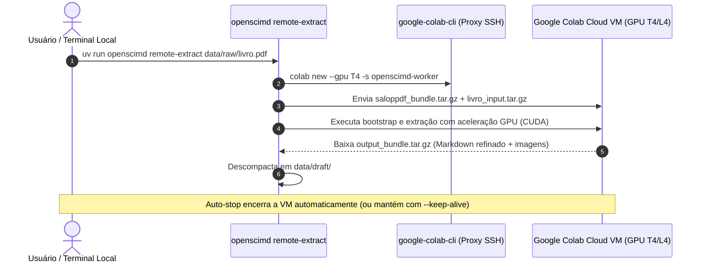

# ☁️ Integração Google Colab CLI & SSH Remoto (OpenSciMD)

Este documento descreve como o **OpenSciMD** descarrega processamento pesado de OCR, visão computacional e extração matemática (MinerU via `saloppdf`) da CPU local para VMs efêmeras aceleradas por GPU no **Google Colab** (assinatura Google AI Pro).

---

## 1. Como Funciona



### Características Principais:
* **Economia de Banda:** Todo o tráfego de ida e volta é compactado em `.tar.gz`.
* **Refinamento com `saloppdf`:** A VM remota executa o pipeline completo do `saloppdf` (incluindo o `MarkdownRefiner`), retornando o Markdown polido e com fórmulas LaTeX intactas.
* **Auto-Stop Nativo:** A VM é desligada imediatamente após a extração, liberando os recursos e economizando créditos de computação da assinatura Google AI Pro.
* **Modo em Lote:** O parâmetro `--keep-alive` permite manter a VM ativa para processar múltiplos livros sequenciais sem pagar o tempo de inicialização novamente.

---

## 2. Configuração Inicial (Uma Única Vez)

### 2.1. Instalação do CLI
Instale a ferramenta globalmente via `uv`:

```bash
uv tool install google-colab-cli
```

### 2.2. Autenticação com a Conta Google
Execute o login interativo:

```bash
colab auth login
```
*O comando abrirá uma janela no navegador para você autorizar o acesso da sua conta Google AI Pro.*

### 2.3. Configuração SSH Local (`~/.ssh/config`)
Certifique-se de que o bloco abaixo está presente no seu `~/.ssh/config`:

```ssh-config
Host colab
    User root
    StrictHostKeyChecking no
    UserKnownHostsFile /dev/null
    LogLevel ERROR
    ProxyCommand colab ssh --proxy-mode -s openscimd-worker
```

---

## 3. Uso no Pipeline OpenSciMD

### Extração Remota Padrão (Auto-Stop)
```bash
uv run openscimd remote-extract data/raw/berdiespezielle00unkngoog.pdf -o data/draft --gpu T4 --lang latin
```

### Processamento em Lote (Mantendo a VM Ativa)
```bash
# 1. Processa o primeiro mantendo a VM aberta
uv run openscimd remote-extract data/raw/livro1.pdf -o data/draft --keep-alive

# 2. Processa o segundo reaproveitando a mesma GPU
uv run openscimd remote-extract data/raw/livro2.pdf -o data/draft --keep-alive

# 3. Finaliza no último
uv run openscimd remote-extract data/raw/livro3.pdf -o data/draft
```

---

## 4. Variáveis de Ambiente (`.env`)

Você pode personalizar o comportamento padrão no seu arquivo `.env`:

```env
COLAB_SESSION_NAME=openscimd-worker
COLAB_ACCELERATOR=gpu
COLAB_GPU_TYPE=T4
COLAB_AUTO_STOP=true
```
